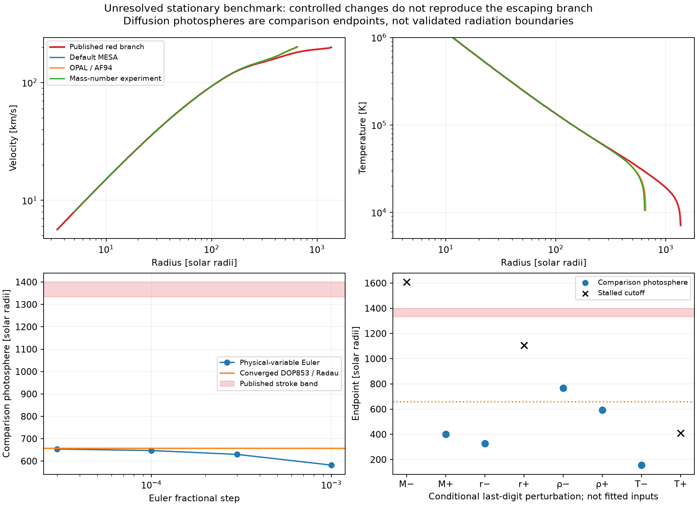

# Report 10 — Outer-closure attribution and conservative interface audit

Assessment: 2026-09-28 UTC. QStarS **0.1.0 development, not v1**.

**Outcome: OUTER FAIL.** Stage A remains scientifically unresolved. Stage B
was not run or interpreted. This is the requested stopping condition, not a
request for another routine approval and not a demonstration that 1D
quasi-stars are impossible.

The new work narrows the stationary benchmark discrepancy, implements
conservative fluxes through moving matching surfaces, and makes the MLT
atmosphere stop at its validity boundary. It does **not** supply validated
escaping radiation or a physical envelope-to-wind match. Complete published
quasi-star evolutionary replicas remain **zero**.

## A1 — Published stationary wind discrepancy remains blocking

The target is Nakauchi et al. (2017), Figure 2's red branch. Its prescribed
M=100 Msun, r_s=50 Rsun, rho_s=9.71e-9 g/cm³ and T_s=250000 K remain unchanged
in every baseline comparison. No coefficient or sonic state was fitted.

The [primary paper](https://arxiv.org/html/1611.09601) specifies H/He
ionization thermodynamics, OPAL opacity above 7000 K and Alexander–Ferguson
opacity below, together with an explicit Euler radial integration. This
campaign recovered the corresponding **MESA-distributed opacity families**,
not the authors' exact EOS, table files, interpolation code or full-precision
run inputs. The MESA AF94 file header says Alexander & Ferguson (1995); that
provenance difference is retained rather than silently relabeled.

| Red-branch comparison | Radius, Rsun | v / local escape speed |
|---|---:|---:|
| Published prose / vector endpoint | about 1400 / 1365.93 | above one |
| Report 9 default FreeEOS/MESA realization | 656.642 | 0.836780 |
| OPAL gs98 / AF94, paper's temperature switch | 656.642 | 0.836780 |
| OPAL gn93 / AF94, paper's temperature switch | **656.788** | **0.836801** |
| Explicit mass-number abundance experiment, OPAL gn93 | 640.551 | 0.828642 |

These are **diffusion comparison photospheres**, not validated escaping
radiation boundaries. A value below local escape speed at such a point does
not prove failure to escape after uncomputed exterior acceleration.

The vector endpoint's radial stroke band is **1333.45–1399.20 Rsun**; its
plotted temperature is about 7099 K. QStarS gives 10468.51 K with the historical
opacity selection. Neither difference is covered by the stroke uncertainty.
The local mass flux is 0.135713 Msun/year, close to the paper's approximate
0.14; matching that scalar does not reproduce the wind.

### What was isolated quantitatively

- **Opacity family:** on identical sampled states of the red branch, the
  gs98/default versus gn93 opacity difference is at most **0.09385%**. Switching
  the family moves the photosphere only **0.0222%**. The computed red branch
  never reaches the 7000 K switch, so AF94 cannot cause this particular
  baseline discrepancy. This excludes the *tested* opacity-family change as
  an explanation; it does not identify the authors' exact opacity realization.
- **EOS abundance convention:** an explicitly named experiment uses nuclear
  abundances X/1 and Y/4 instead of X/A_H and Y/A_He. It reuses unmodified
  FreeEOS at transformed density/composition and transforms extensive
  quantities consistently. Its sampled first-law defect is **1.12e-8**.
  It moves the radius about **2.47% in the wrong direction**. This is neither
  the recovered original EOS nor a proposed replacement production EOS.
- **Integration method:** reconstructing Euler updates in physical r, v and
  T with the paper's fractional-step prescription gives the results below.
  The density and luminosity still follow the exact stationary invariants;
  the original authors' sonic-start implementation is not specified.

| Euler fractional step | Comparison photosphere, Rsun | Change from converged ODE |
|---:|---:|---:|
| 1e-3 | 582.220 | -11.35% |
| 3e-4 | 629.917 | -4.09% |
| 1e-4, the published nominal step | 647.261 | -1.45% |
| 3e-5 | 653.864 | -0.445% |

The reconstructed Euler sequence approaches the high-order result. It does
not explain the factor-of-two discrepancy. **The Euler profiles themselves
are not converged to the 0.1% target**: the narrow outer thermal layer remains
sensitive to endpoint displacement. They are attribution experiments, not a
new production integrator.

- **Printed precision:** rho_s ±0.005e-9, half the last displayed digit,
  produces photospheres at **767.57 and 592.91 Rsun**, both still below the
  published band. A separate, predeclared conditional design uses
  M ±0.5 Msun, r_s ±0.5 Rsun, rho_s ±0.005e-9 and T_s ±5000 K: eight axis
  samples and all 16 corners. Of 24 cases, 13 reach the comparison photosphere
  and 11 reach a stalled-branch cutoff; none meets the paper's photospheric
  escape criterion. This sample set is **not an interval enclosure**, a
  probability distribution, or evidence that the authors rounded nominal
  model parameters. It cannot exclude unsampled solutions or certify a fit.
- **Radial coverage:** extending only the inward integration from 5 to
  2.5 Rsun removes all missing inner samples. Using the paper's stalled
  cutoff, Mach 1.5, moves the black-branch endpoint from 1484.33 to
  1401.44 Rsun without changing the overlapping solution. The red branch
  still stops too early. With propagated horizontal/vertical stroke widths,
  **2257 of 2331 compared samples pass; 103 remain outside coverage**.
  Central sample coordinates alone leave 121 outer points uncovered; the
  different counts come from allowing stroke-band overlap, not discarding data.
- **Diffusion validity:** the stricter R_E=0.1 screen terminates the red branch
  at **641.42 Rsun, T=17450.51 K**. The paper comparison condition T=Teff gives
  R_E=0.75, beyond that domain. Inability to certify diffusion there does not
  explain why two implementations of the same diffusion equations disagree.

The initial campaign used the label `photo_rsun` for every endpoint, including
stalled cases. The raw artifact and frozen driver are preserved. The
[normalized analysis](evidence/outer_report10_20260928/analysis/normalized_cases.json)
corrects the label only in a derived copy and records the raw file hash;
current scripts distinguish the endpoint types. In particular, a 0.5% mass
perturbation's 1607-Rsun endpoint is **stalled, not a photosphere**.



### Numerics remain converged for the reference equations

All **42 attribution integrations completed**. DOP853/Radau, tighter
tolerance, smaller maximum step, smaller sonic offset and a refined critical
point derivative agree to **2.95e-5 maximum log-profile change** and
**4.96e-8 relative endpoint-radius change**. Compared fields include density,
temperature, velocity, gas pressure, ionization, opacity and radiative
luminosity. Targets remain 0.001 in log profiles and relative endpoint radius,
well below the physical discrepancy.

For the historical-opacity red baseline, independent first-law, momentum and
diffusion integral defects are **5.09e-9, 1.65e-10 and 1.12e-11**, respectively,
below the existing 1e-6 component target. These supplement algebraic flux
identities. They do not validate the diffusion approximation itself.

**A1 disposition: unresolved and blocking.** Known tested substitutions and
numerical differences explain only a small part of the radius mismatch.
Strong branch sensitivity makes recovering the original EOS/inputs useful,
but does not identify a causal explanation. No matching-looking case was
selected or promoted.

## A2 — Escaping radiation remains unvalidated

No new escaping-radiation closure is promoted in this campaign. The current
strict wind calculation stops at its diffusion validity limit; the explicitly
named `paper_photosphere` continuation is a benchmark diagnostic only.

The new native interfaces return Rosseland means. They do not supply a
validated flux mean outside diffusion, absorption/emission exchange with a
non-LTE radiation field, or angular radiation moments through the expanding
photosphere. A numerical flux limiter would constrain flux magnitude, but
would not by itself establish those missing physical quantities. Likewise,
setting a grey blackbody temperature would not determine the external
ionization state or radiative acceleration.

The established transfer alternatives and their assumptions remain in the
[method audit](../docs/spherical_wind.md), including expanding CMFGEN models.
There is no calibrated comparison to such a solution for the current physical
base states. **Emergent luminosity, photosphere and Teff are therefore not
certified production outputs.** A2 remains FAIL; this is a missing validated
capability, not a claim that suitable 1D transport is impossible.

## A3 — Moving-surface accounting passes; physical matching remains open

`DiffusionWind.boundary_flux(..., face_velocity=u)` now returns lab-frame
conserved fluxes through a moving sphere of area A. With relative mass flux
m_dot=A rho (v-u), static central potential Phi, and LTE enthalpy h,

\[
 F_E=L_{\rm diff}+\dot m\,(h+v^2/2+\Phi)+A(P_g+P_r)u.
\]

The last term is essential: a comoving surface still receives pressure work
and radiative transport. Mass, momentum, gas and radiation internal energy,
relative enthalpy work, moving-surface work, kinetic/potential energy and
advected entropy remain separately available.

Independent integration over volumes swept by two moving faces agrees with
these mass/energy fluxes to **2.11e-10 relative**, versus a 2e-7 verification
target. Three displacements test the comparison. A comoving-face control and
an arbitrary constant gas-energy shift verify pressure work and energy-gauge
behavior: changing the gauge changes the flux by the **relative** mass flux
times the energy offset.

This is a conservative interface, **not an evolving envelope, moving cavity,
or reconstructed wind boundary**. Report 9's known-solution matching tests
remain component evidence. Its failed physical-base experiments remain
failed; no new physical base match is claimed. In particular, optimizer
failure or an inadmissible trial critical slope still does not prove that a
physical root does not exist. A3 overall remains FAIL.

## A4 — Explicit MLT validity exit

The hydrostatic atmosphere reference now stops on a resolved event at local
convective Mach one, using the EOS adiabatic sound speed. It raises a
structured `AtmosphereDomainExit` carrying optical depth, thermodynamic state,
velocity and the explicit absence of a physical-impossibility claim. It does
not return a supersonic MLT profile or clip the convective velocity.

For Teff=6000 K, g=1 cm/s², the Henyey and ML1 exits occur at tau=**2.8369243**
and **2.8369494**, T≈7635 K. Refining tolerance from 1e-7 to 1e-9 and changing
output sampling changes the exit depth by about **3.83e-7 relative**. Archived
Report 8 profiles beyond this limit remain historical invalid diagnostics.

This supplies the allowed validity-exit option for local MLT. It does not
validate setting convection to zero at an arbitrary wind base, nor supply a
turbulence model. Such base states remain ineligible for production coupling.

## Gate matrix

| Required gate | Status | Evidence and qualification |
|---|---|---|
| Stationary wind numerical convergence | PASS, component scope | 42 runs; profile and independent integral checks above |
| A1 published stationary reproduction or defensible explanation | **FAIL** | Red radius, temperature, coverage and escape criterion remain discrepant |
| A2 justified escaping-radiation treatment | **FAIL** | No validated expanding exterior, flux mean or emergent observables |
| A3 physical envelope-to-wind eigenvalue match | **FAIL** | Manufactured recovery remains distinct from physical-base validation |
| Conservative moving-surface flux accounting | PASS, component scope | Swept-volume, comoving-face and energy-gauge checks |
| A4 explicit MLT validity exit | PASS for rejection policy | Mach-one event; no turbulent/outflow closure implied |
| Stage A overall | **FAIL** | The required conjunction does not pass |
| Stage B coupled evolution, convergence and full track | **FAIL / prerequisite unmet** | Not run; no coupled physical result claimed |
| General QStarS v1 | **FAIL** | Outer closure plus earlier cavity, full-track and cross-validation gates remain |

The complete continuing v1 matrix is
[`completion_gates.json`](evidence/completion_gates.json). No earlier gate was
waived, and QSRD remains deferred.

## Reproducibility, failures and MacBook performance

Pinned libraries: MESA 24.08.1 / SDK 24.7.1, new bridge ABI 6 at
`backends/mesa/build_outer_2`, and direct FreeEOS 3.0.0 bridge 2. Historical
opacity handles are separate from the default handle; table-node regressions
also verify that querying them does not change default opacity results.
The default MESA/FreeEOS limitations from Reports 8–9 remain applicable.
Final review also retained an independent second-sonic guard when an optional
higher comparison Mach cutoff is never reached. A new regression checks
that such a cutoff cannot disable the original safety exit; default wind
ODEs and the completed comparison cases are unchanged.

The first native build failed because two table names are not direct members
of MESA's public handle type. The repair uses the public control setter and
reinitializes the table selections. The failed source is reconstructed and
verified against its recorded SHA256; both build logs/manifests are retained.
No upstream physical data or MESA source was edited.

- Attribution campaign: **205.23 s, 676.58 MiB peak RSS**, including 42 runs.
- Moving-interface/MLT/coverage campaign: **31.74 s, 555.00 MiB peak RSS**.
- Full regression suite: **76 passed in 32.69 s** with both native libraries.
- `qstars validate --quick --require-v1`: **exit 2**, with the two retained
  CB24 printed-value discrepancies; this command is not the full gate matrix.

These measured components remain practical on the current Apple M5 MacBook.
No coupled-track performance is reported. Future independent parameter sets
can use separate CPU processes; native MESA calls are not thread-safe.
Large convergence campaigns may benefit from cloud CPU after their physical
prerequisites pass. That is a workload recommendation, not an unmeasured
scaling result.

[Archived results](../benchmarks/results/2026-09-28-outer-audit) include all
profiles, Euler steps, failed-build evidence, dependency hashes, configuration,
frozen package snapshots and original drivers. Each campaign verified its
source snapshot. The two campaigns span the interface/MLT hardening; the wind
ODE equations were unchanged between them. Analysis and tests are in
[`evidence/outer_report10_20260928`](evidence/outer_report10_20260928).

Reproduce with the two native-library environment variables and `MESA_DIR`
set to the pinned builds, then run:

```sh
.venv/bin/python scripts/validate_outer_discrepancy.py
.venv/bin/python scripts/validate_outer_transport.py
.venv/bin/python scripts/analyze_outer_discrepancy.py DISCREPANCY_DIR TRANSPORT_DIR --output ANALYSIS_DIR
.venv/bin/pytest -q
```

The benchmark suite and 37-entry source registry are updated. The precise
next scientific requirements are an attributable stationary reference,
validated expanding radiative transfer and an admissible physical base match.
This report stops at Stage A as instructed.
