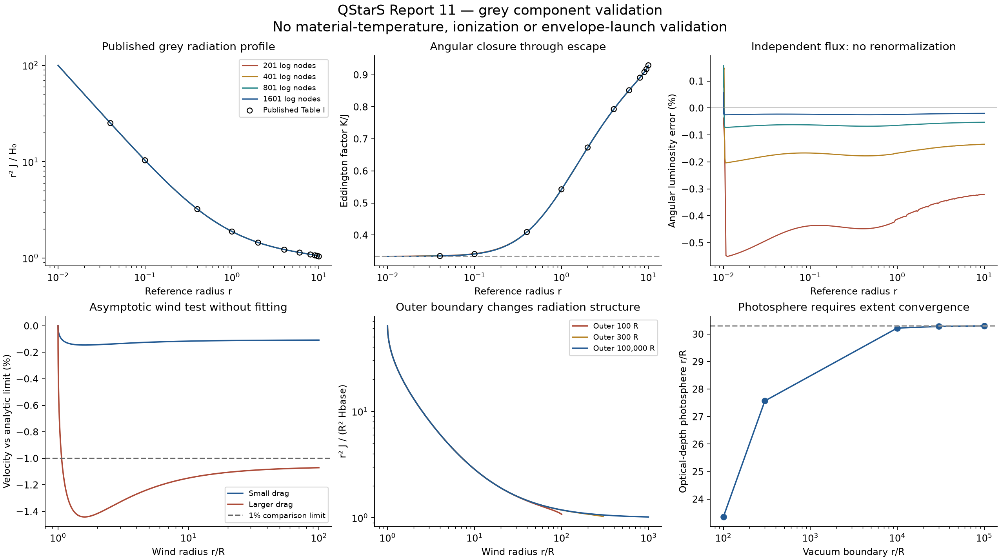

# QStarS Report 11 — escaping radiation and reproducible grey controls

**Outcome: OUTER CLOSURE FAIL.** QStarS remains development version 0.1.0, not v1.

A reproducible spherical angular-transfer component now passes scoped validation, and a constructed stationary continuum wind passes numerical and small-drag analytic comparisons. The original physical boundary is still unresolved: grey scattering does not provide a recombining gas temperature/ionization solution, and the new wind's mass flow and base velocity are inputs rather than an envelope-selected sonic solution. These are distinct essential gaps, so CONDITIONAL overall would overstate readiness. No coupled stellar evolution, full published evolution or QSRD calculation was run.

Report 10's attribution campaign was not repeated. Its Nakauchi discrepancy and Mach-one MLT exit remain in force.

## Deliverables and source selection

- [Implementation and equations](../docs/escaping_radiation.md): static and moving spherical angular transfer, frame transformations, radiation work, independent flux checks and conservative future matching conditions.
- [Candidate registry](../benchmarks/outer_candidates.json): nine audited families with the requested availability, microphysics, sonic/boundary conditions, input scales, outputs and determinism fields.
- [Published numerical reference](../benchmarks/hummer1971_table1.csv) and [transcription provenance](../benchmarks/hummer1971_table1_provenance.json).
- [Exact stationary control](../benchmarks/grey_continuum_wind.json), [initial tolerances](../benchmarks/escaping_transport_tolerances.json) and [targeted follow-up protocol](../benchmarks/escaping_followup_plan.json).
- [Machine comparisons and figure](evidence/escaping_20260928/analysis/analysis.json), [archived runs](../benchmarks/results/2026-09-28-escaping/archive_manifest.json), and [release gate matrix](evidence/completion_gates.json).
- Nine new regression tests; **85 tests pass with native MESA and FreeEOS enabled**, in **34.29 s**.

The strongest public code candidates were SIROCCO (specified-flow non-LTE transfer), MPI-AMRVAC's spherical CAK case (line driving), and DUSTY (dust transfer/winds). Exact commits and inspected input hashes are recorded. They cannot validate a primordial continuum mass-loss eigenvalue merely because source is available. None was silently installed, substituted for the stellar solver or represented as an executed benchmark.

We selected Hummer & Rybicki's 1971 Table I for independent spherical radiation validation. For stationary force/energy verification we constructed an exact-input control using Owocki et al.'s 2017 analytic flux-driven limit, extended with an explicitly specified finite base speed. The numerical control uses moving transfer and measures its difference from the small-drag approximation. This is a reproducible component benchmark, **not a complete published thermodynamic wind replication**. Fukue's 2018 equations supply the moving-transfer formulation; his relativistic figure families are not claimed reproduced. Nakauchi remains an additional failing benchmark.

## What changed

`grey_transfer.py` solves the angle-dependent bolometric transfer equation on spherical tangent/core rays. Angular moments determine a variable Eddington factor; no empirical limiter or fitted flux bridge is used. The static solver advances the conservative moment equation with an inner diffusion boundary. The moving solver includes the lab/comoving intensity transformation, direction-dependent path opacity and coherent-scattering radiation work. It retains moment and independently integrated angular fluxes separately.

A new sixth-order Gauss moment integrator visits every tabulated radial interval and checks local error by step doubling. This fixed the adaptive integrator's sensitivity to narrow closure features. Merging isolated nearly coincident points in the benchmark's combined radius/optical-depth grids avoids amplified interpolation slopes. Neither change alters a physical coefficient or a reference value.

`continuum_wind.py` iterates the moving radiation with pressure-free stationary momentum. Its supplied mass current fixes density, and radiation work is consistent with its declared Newtonian kinetic-plus-potential energy convention. It returns radiation energy, flux, acceleration, optical-depth photosphere, emergent luminosity and an effective-temperature diagnostic. Material temperature, ionization, gas entropy/enthalpy and sonic radius remain explicitly missing. The implementation is a separate reference API; the evolving-star configuration cannot select it as a validated boundary.

## Quantitative radiation validation

The final Hummer n=2, R=10 comparison uses all 11 tabulated radii and both J and K/J:

| Measurement | Result | Declared acceptance |
|---|---:|---:|
| Largest published J difference | 0.3683% | 0.5% interior, 1% surface |
| Largest published K/J difference | 0.0927% | 0.5% interior, 1% surface |
| J profile, 801 vs 1601 log-radius nodes | 0.01395% | 0.2% |
| K/J profile, 801 vs 1601 nodes | 0.03288% | 0.2% |
| Inner-depth changes, tau=30/100/300, common r>=0.04 | at most 0.01378% | 0.2% |
| Outer placement 300 vs 1000, common r<=3 | at most 0.01418% | 0.2% |
| Closure tolerance 1e-7 vs 1e-9, J profile | 2.38e-8 relative | 1e-5 |
| Moving J/H/K profiles, 401 vs 801 nodes | at most 0.01756% | 0.2% |

The finite luminous-disc transparent limit checks all three angular moments against closed forms. Separate boosted-isotropic angular integrals check the Lorentz transforms. Thick limits and the escaping flux/Eddington factors are tested. Luminosity and radiation work are checked through independently integrated angular moments, not only the constant-flux or conservative moment unknown.

An original n=1.5 comparison at tau>=30 failed the leading diffusion asymptotic: 0.823% in J and 0.00292 absolute in K/J. This is retained. For that opacity law the leading radiation-gradient Knudsen number there is approximately 0.16, so tau=30 is not sufficiently deep for the requested asymptotic accuracy. Extending the inner depth to 300 and comparing at tau>=100 gives J error 0.0872% and K/J error 0.000356, within the unchanged limits. This does not establish LTE in an actual gas.

## Stationary continuum control and outer convergence

The primary nondimensional control is Gamma=2, m=0.001, v_escape/c=1e-4, w_base=1e-4. Its actual scattering optical depth is about 40. For the 801-node, 100R comparison:

| Profile/accounting comparison | Largest discrepancy |
|---|---:|
| Velocity vs analytic small-drag reference | 0.1449% |
| Density vs reference | 0.1451% |
| Luminosity vs reference | 2.13e-6 relative |
| Radiative acceleration vs reference | 0.1602% |
| Photosphere vs reference at the same finite exterior | 0.0832% |
| Whole energy flux | 3.73e-9 relative to initial total flux |
| Independent angular momentum integral | 0.0788% of maximum wind kinetic variable |
| Independent angular radiation-work integral | 7.77e-7 of base luminosity |

Numerical comparison of 401 and 801 nodes gives errors below **0.0471%** across velocity, density, J, H, K and acceleration. Tighter iteration tolerances change these profiles by at most 2.80e-6 relative. Doubling core-ray resolution changes them by less than 8.72e-7. Gamma=4, m=0.0005 and v_escape/c=0.0002 gives velocity and force discrepancies of 0.1037% and 0.1717% against its analytic reference, without retuning.

However, a finite vacuum boundary at 100R was **not** adequate as an infinite exterior: moving it to 300R changed J by 9.73% on the comparison domain and moved the photosphere from 23.350R to 27.571R. Agreement with an analytic calculation using the same short exterior would have hidden that error.

The follow-up extends the exterior to 10,000, 30,000 and 100,000R. At 100,000R, the photosphere is **30.30085R**, L_out/L_base=**0.99800415**, F/(cE)=**0.99989991**, and K/J=**0.99982651**. The 30,000/100,000R comparison gives:

- Maximum J-profile difference: **0.01394%** on 1–1000R; all other compared profiles also pass 0.2%.
- Photospheric-radius difference: **0.06947%**; effective-temperature diagnostic difference: **0.03476%**.
- Luminosity difference: **4.65e-8 relative**.
- Independent angular flux agrees with the moving moment flux within **0.123%** in the most extended calculation.

The 10,000R photosphere still differs by **0.2679%**, above the unchanged 0.2% limit, and stays marked FAIL. No tail fit was used.

The optional 100-Msun, kappa=.34 dimensional scaling is deliberately **not a physical star**. Its inferred effective temperature is only about 268 K and its wind mass through 100,000R exceeds the central mass by about 3249. It cannot justify fully ionized opacity or neglected wind self-gravity. The nondimensional control verifies defined equations and asymptotic behavior; changing its label would not validate a quasi-star.

## Failures preserved

The final main campaign contains 31 attempted cases: 30 completed components and one deliberately insufficient-iteration failure. Of 165 checks, 156 pass and nine fail. The extent/deep-asymptotic follow-up has 35 checks, 34 passing. **190/200 checks pass; the remaining ten are visible**, rather than hidden by an all-green summary.

Retained failures include the coarse 201-node Eddington profile, the insufficiently deep n=1.5 asymptotic comparisons, the short outer boundary, and the 10,000R photosphere. A converged direct source solve at tau=30 loses **35.98%** of its angular luminosity on the coarse grid despite its tiny algebraic residual; it is not promoted as accurate transport. A larger-drag wind fails the small-drag analytic approximation by **1.44% in velocity** and **1.575% in force**, as an explicit negative control. That is an approximation failure, not a claim that the numerical wind does not exist.

The first formal campaign also failed to reach the strict closure tolerance and its analysis driver aborted when it tried to read the missing output. Its source snapshot, partial cases, traceback and comparisons are archived. The final driver retains failed cases and failed comparison prerequisites without aborting subsequent tests. Exploratory logs and intermediate source versions are retained separately and are not counted as formal validation evidence.

## Current outer gate matrix

| Gate | Status | Evidence and boundary |
|---|---|---|
| Candidate audit and reproducible reference specification | PASS | Nine explicit records; published table and exact-input stationary control |
| Published spherical grey radiation moments | PASS | Full Table I profile comparison plus diffusion/streaming and independent flux checks |
| Moving grey radiation work and numerical convergence | PASS | Specified isotropic scattering, 0<=v/c<=0.01; radial/core/tolerance/extent tests |
| Stationary continuum verification family | PASS | Scoped pressure-free, fixed-grey, supplied-mdot control and second parameter set |
| Required thermodynamic quasi-star stationary wind benchmark | CONDITIONAL | Reproducible limiting target exists; realistic T/ionization/sonic launch not supplied |
| Escaping transfer for the original recombining envelope/wind | FAIL | No validated frequency-dependent/appropriate flux means or material population/energy closure |
| Physical envelope-to-wind mass-loss match | FAIL | New control lacks the thermodynamic unknowns and mdot eigencondition; no physical match claimed |
| Mach-one MLT exclusion | PASS | Existing guard retained; full native regression passes |
| Convective-envelope handoff | FAIL | No validated steady transition; excluded states remain excluded |
| One conservatively coupled evolving envelope | FAIL | Not run: user-required physical prerequisites do not pass |
| First complete published quasi-star evolution | FAIL | Not attempted; zero complete replicas |
| General v1 / QSRD readiness | FAIL | Existing cavity, production microphysics, evolution and cross-family gates remain open |

The [matching derivation](../docs/escaping_radiation.md#what-prevents-physical-envelope-matching) retains lab radiation flux, swept radiation energy/momentum and gas work. It distinguishes conservation jump conditions from optional thermodynamic continuity. A derivation is not a solved matching layer. Neither supersonic MLT nor an assumed saturated-convection coefficient is used to fill the gap.

## Performance and reproducibility

On the Apple M5 / 16 GiB MacBook, the final main campaign took **55.42 s**, peaking at **745.03 MiB**. Individual 401/801-node wind controls took **3.95/8.13 s**. The extent campaign took **68.63 s**, peaking at **1213.56 MiB**; its 2001-log-node, 100,000R wind took **25.95 s**. These sequential component measurements exclude plotting and are not full quasi-star evolutionary performance estimates. Cloud CPU resources may help independent larger grids; no GPU or cloud scaling claim is made.

The three formal/partial run directories are archived with **132 files, all SHA256-verified**, including raw profiles, iteration histories, inputs, copied drivers and frozen package snapshots. Both completed campaigns pass unchanged-source checks. The first partial campaign was finalized with a verified snapshot before the numerical repair. Original result directories remain intact. Source registry entries now total **41**. The [verification record](evidence/escaping_20260928/verification.json) identifies final code/data hashes and regression results.

Run `scripts/validate_escaping_radiation.py`, then `scripts/validate_escaping_extent.py` for the complete numerical evidence. Neither driver authorizes coupling or silently promotes the development release to v1.

