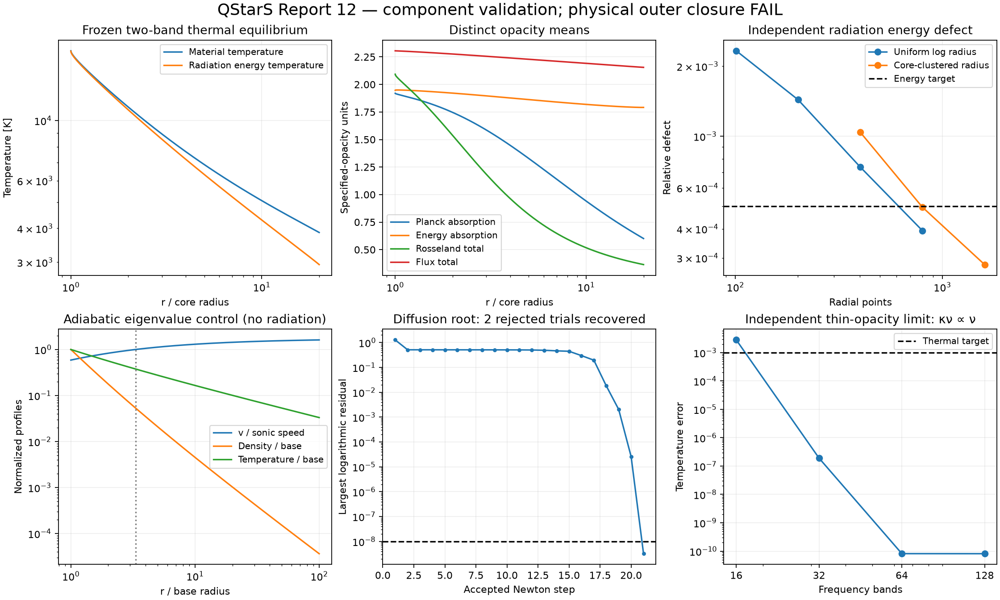

# Report 12 — thermodynamic transfer and self-selected wind prerequisites

**Outcome: FAIL.** QStarS still lacks the necessary combined thermodynamic, population, convective and escaping-radiation closure through which a physical quasi-star envelope determines its own mass loss. No production mdot prescription was added, no physical envelope was attached, and no coupled evolution, complete published track or QSRD run was performed. The release remains **0.1 development, not v1**.

The work closes several component and numerical gaps: absorption/emission with distinct gas/radiation temperatures; four correctly distinguished opacity means; a gas energy equation with native FreeEOS derivatives; a controlled wind eigenvalue with no mdot/base-speed input; recovery from inadmissible sonic trial states; and a general conservative moving interface. These components have deliberately different validity domains. Combining their separate passes would not establish the requested physical closure.

## Deliverables

- [Equations, boundary conditions, degree-of-freedom reasoning and validity domain](../docs/self_selected_outer.md).
- [Initial numerical protocol](../benchmarks/self_selected_plan.json) and [targeted refinement protocol](../benchmarks/self_selected_refinement_plan.json), including fixed error thresholds.
- [Machine analysis](evidence/self_selected_20260928/analysis/analysis.json), [raw archived campaigns](../benchmarks/results/2026-09-28-self-selected/archive_manifest.json), [archive verification](evidence/self_selected_20260928/archive_verification.json), and [release gate matrix](evidence/completion_gates.json).
- Twelve additional regression tests, including a real native-library rejected-trial recovery. **97 tests pass with MESA and FreeEOS enabled, in 50.52 s.**
- Source registry expanded from 41 to **47** entries. Three additional primary papers are cached and SHA256 recorded; scientific availability is distinguished from actual installation or replication.

## What the microphysics audit established

The installed MESA opacity is a Rosseland mean; FreeEOS is an LTE equilibrium thermodynamic backend. Neither gives the absorption/emission, flux mean or externally irradiated populations required by an exposed recombining wind. They remain useful inside their existing screened domain. This is a specific missing interface/validation capability, **not a claim that thermodynamic 1D quasi-star winds are physically impossible**.

The [Malygin two-temperature opacity work](https://arxiv.org/abs/1408.3377), [Mayer–Duschl primordial mean-opacity work](https://arxiv.org/abs/astro-ph/0411613) and [Sander hydrodynamically consistent non-LTE method](https://arxiv.org/abs/1704.08698) were inspected. Their composition, equilibrium and boundary assumptions are recorded in the source registry and equations document. None supplies a ready, validated primordial quasi-star boundary through the installed MESA/FreeEOS calls. SIROCCO remains an existing transfer candidate; its specified-flow example is not a mass-loss eigenvalue model. No non-LTE library was installed or represented as executed in this campaign.

There is no justified universal minimum frequency count yet. The required production treatment must resolve the important H/He continuum/line absorption, emission and radiation force and validate populations against relaxation and flow times. The new smooth-opacity frequency test establishes a numerical limit only. It does not show that 32 bands suffice for an actual recombining spectrum.

## Thermal transfer results

The new static spherical solver uses frequency-band true absorption, Kirchhoff emission and isotropic coherent scattering. It solves the material radiative-equilibrium temperature rather than imposing equality with the radiation energy temperature. Coefficients are explicitly synthetic, frozen in state and constant within each band. No H/He opacity or statistical atom is invented.

In the two-band control, at 20 core radii, the refined result gives **Tgas=3861.19 K** and **Trad=2938.65 K**. The flux mean differs from the Rosseland mean by as much as **a factor 5.911**. Those numbers demonstrate why substituting a mean or equating temperatures is unjustified even in this simple declared problem; they are not a predicted quasi-star atmosphere.

| Measurement | Result | Acceptance |
|---|---:|---:|
| Independent radiation energy integral, 1601 clustered points | 0.02809% | 0.05% |
| Largest Tgas/E/F/Prr/force difference, 801 vs 1601 clustered points | 0.02721% | 0.2% |
| Exterior 60 vs 180 core radii, common 1–10 core radii | 0.03759% | 0.2% |
| Independent energy integral at refined exterior 180 | 0.04674% | 0.05% |
| Smooth opacity kappa_nu proportional to nu, 16 bands | 0.2811% temperature error — FAIL | 0.1% |
| Same analytic limit, 32 bands | 1.902e-7 relative | 0.1% |
| Same analytic limit, 64/128 bands | approximately 8.2e-11 relative | 0.1% |

The analytic temperature limit is Tgas=Tstar times W^(1/5), with independently known geometric dilution W. Exact absorbing/emitting spherical chord integrals also check J/H/K; adaptive Planck integration checks the band quadrature and derivatives. There is no luminosity renormalization.

The first uniform-log grids gave small local thermal residuals but failed spatial checks. Energy defects were 0.2328%, 0.1434% and 0.07378% at 101/201/401 points, above 0.05%. The 401/801 radiation-energy comparison differed by 0.7336%. A luminous core has a square-root limb variation, so the follow-up used log(r/Rcore)=log(Rout/Rcore) times s² with uniform s. The coefficients, boundary data and tolerances remained unchanged.

Not every refined case passed: 401 clustered points still fail the energy integral at 0.1041%, and the 801-point exterior-60 case fails at 0.06100%. Their profile comparisons pass, illustrating that internal convergence and conservation must both be checked. The finer exterior-180 result passes the integral. Extinction optical-depth radii remain band-specific diagnostics, not validated thermal photospheres or emergent spectra of real matter.

## Mass flux selection and material critical point

The separate material-energy operator includes gas pressure, internal energy and entropy derivatives directly from FreeEOS. Eliminating its independent temperature gradient changes the local critical denominator to the appropriate adiabatic gas derivative combination when the heating/force have no explicit velocity-gradient dependence. Native gas gamma1 independently verifies that combination at 12 states. Across those states the adiabatic/isothermal gas sound-speed ratio is **1.09356–1.29100**. Report 9's diffusion critical condition is retained for its own different equations; it is not silently reused for a two-temperature wind.

A new adiabatic Parker verification family determines mdot from base radius, mass, density and pressure. No mdot or base velocity is an input. Sonic regularity, constant entropy and Bernoulli conservation provide an explicitly bracketed root over the entire supported accelerating interval. For the baseline mathematical fluid (gamma=4/3, M=100 Msun, rb=1e12 cm, rhob=1e-10 g/cm³, GM/(rb ab²)=2.5), the selected values are:

- mdot = **3.31034195e22 g/s**;
- sonic radius = **3.31647164e12 cm**;
- base velocity = **2.63428642e7 cm/s**;
- asymptotic velocity = **7.74764779e7 cm/s**.

An independent implicit Bernoulli solution checks density at multiple radii. Integrated density, pressure, velocity, specific internal energy, temperature ratio, entropy proxy and energy partition are compared, including rematching from three subsonic radii. A second gamma/base-binding case runs without coefficient changes. For the explicitly bounded family with insufficient base enthalpy, the solver identifies a finite hydrostatic atmosphere with an analytic no-accelerating-root argument. Other unsupported inputs return a domain exit. This is not a general no-wind classification for quasi-stars.

Sparse sampled output initially failed the 1e-6 profile target even though conserved energy was accurate. Increasing the stored samples gives **4.151e-7** maximum density/pressure/velocity difference for 2001 vs 4001 samples per side; moving the exterior from 100 to 1000 base radii gives **3.031e-7** on the common range. Fine total energy defects are **below 8.0e-15**. Earlier sparse-output failures remain visible.

This is a calorically ideal, zero-radiation mathematical control. It supplies neither realistic H/He thermodynamics nor an escaping radiative solution. It is an independent eigenvalue verification, not the first physical-envelope test requested in stage 10.

## Diffusion matching robustness

The existing FreeEOS/MESA sonic matcher now retains rejected local trials and backtracks. Six broad/near-guess recoveries at three matching radii recover a known component's mass flux within **4.37e-8 relative**, with logarithmic boundary residuals below 1e-8. Deliberately exhausted searches preserve their trial histories and return numerical failure.

A distant guess with sonic factors [1.1, 0.1, 0.8] generates **two rejected trial states with complex critical slopes**, then converges through admissible smaller steps. The recovered mass-flux error is **8.26e-8**. This verifies a failure mode that formerly aborted the root finder. It does not prove global uniqueness; loss of rank or a stalled line search still requires branch/continuation work. The bases in this experiment are slices of a known wind, not physical stellar envelopes.

## Conservation and convective handoff

The implemented interface accepts independent lab E/F/Prr and subtracts swept radiation energy and momentum at a moving surface. Gas internal energy, gas work, moving pressure work, kinetic energy, potential energy, lab radiation flux and swept radiation energy are recorded separately. Gas energy gauges must agree. Independent Reynolds identities, a normal shock with a temperature discontinuity, a comoving surface and an energy-gauge shift are tested. A changed mdot fails flux matching unless the corresponding material/radiation energy changes are supplied; no balancing energy is created.

A conservative zero-thickness jump is distinct from a solved finite layer. Its entropy production, radiation spectral compatibility and dynamics remain additional physical constraints. Outward luminosity at a finite face is not automatically escaping radiation.

The Mach-one MLT guard remains active and passes the full regression suite. The prior literature alternatives—saturated convection, porosity, turbulent pressure and heating-driven trapped winds—were assessed against the new conservation requirements. A capped MLT flux alone does not specify where excess energy, stress or dissipation goes. No arbitrary cap, turbulence pressure term or porosity coefficient was added to manufacture a match. A validated convective handoff remains a separate blocker.

## Gate matrix

| Required gate | Status | Evidence or missing capability |
|---|---|---|
| Static absorption/emission with distinct gas/radiation temperatures | PASS, component scope | Frozen-band thermal balance, analytic spectra/chords, independent energy and refinement |
| Realistic recombining matter/radiation thermodynamics | FAIL | H/He frequency coefficients, statistical populations and material advection are not jointly solved |
| Correct opacity-mean separation | PASS, component scope | Separate Planck, energy, Rosseland and flux means; no substitution |
| Minimum production frequency/non-LTE treatment | FAIL | Synthetic convergence does not validate real H/He spectra/populations |
| No-prescribed-mdot eigenvalue mechanism | CONDITIONAL | Adiabatic base-selected control and local diffusion matches pass; production radiative envelope match missing |
| Convective-envelope handoff | FAIL | MLT exclusion retained; no independently validated stress/transport transition |
| Conservative matching fluxes | PASS, component scope | General lab-moment Reynolds ledger and independent jump tests |
| General stationary/hydrostatic/multiple-branch classification | CONDITIONAL | Scoped analytic reference proof; full coupled branch search absent; failures remain numerical |
| Independent full thermodynamic radiative wind benchmark | FAIL | Analytic components pass; no complete published population-consistent escaping wind reproduced |
| Mesh/tolerance/critical/exterior/matching-radius robustness | CONDITIONAL | Refined controls pass; 23 coarse/comparison failures retained; no coupled timestep/restart/remesh campaign |
| Physical quasi-star envelope selects its outer solution | FAIL | Not attempted because necessary component physics does not pass jointly |
| Coupled self-selected evolution | FAIL | Not attempted; prior gate does not pass |
| Complete published quasi-star evolution | FAIL | Zero complete replicas; no static result substituted |
| General v1 / QSRD | FAIL / deferred | Existing cavity, evolutionary and cross-family requirements also remain open |

## Performance, preserved evidence and next necessary work

On the Apple M5 / 16 GiB MacBook, the main 34-case campaign took **105.08 s**, peaking at **762.42 MiB**. Thirty components completed and four deliberate iteration/budget failures were preserved. The nine-case refinement took **156.50 s**, peaking at **936.75 MiB**. The 1601-point thermal case took **51.39 s**; native distant-guess recovery took **17.65 s**. No cloud or GPU execution was needed. Larger group/ray refinements and independent physical benchmarks can benefit from cloud CPU and memory; this is not a measured cloud speedup or evolutionary runtime.

Across both campaigns **116 of 139 numerical checks pass**. The other **23 remain FAIL**. These are quantified coarse-grid, short-exterior, spectral-resolution and sampled-profile discrepancies; later passing refinements do not erase their original outcomes. Both package snapshots match the current tested package exactly, and **all 89 archived files pass SHA256 verification**. Raw moments, temperatures, wind profiles, native critical states, rejected trials, inputs, copied drivers and frozen sources are retained. Exploratory probes are stored separately and are not counted as formal campaigns.

The next necessary physical work is to integrate and validate an appropriate existing atomic/transfer backend, with consistent non-LTE population energy and momentum/thermal source terms, then solve its coupled boundary/eigenvalue problem through a defensible subsonic convective handoff. More synthetic controls alone cannot close that gate. Nothing in this report supports claiming the requested self-selected outer PASS or releasing v1.

