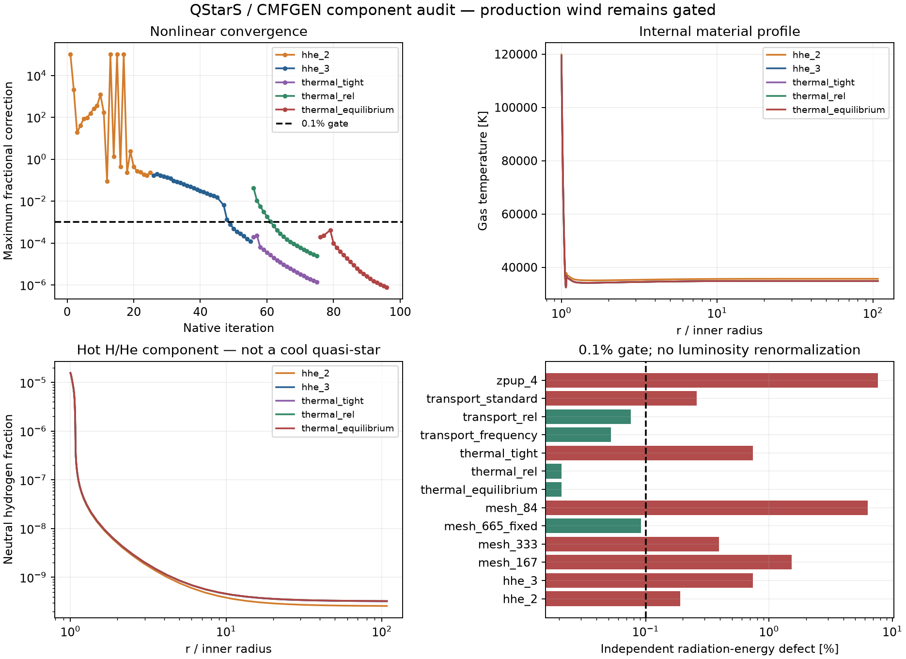
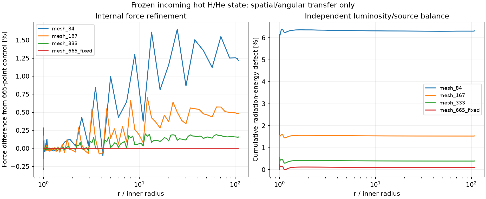

# Report 13 — native non-LTE backend selection, integration and validation

**Outcome: BACKEND/PHYSICS BLOCKER.** CMFGEN is the selected and installed physics route, with a working native Apple Silicon executable and QStarS diagnostic interface. It does **not yet close the coupled quasi-star wind**. No physical envelope has selected mdot or demonstrated a conservative escaping quasi-star wind. No coupled evolution or complete published evolutionary track was run; QSRD remains deferred. QStarS remains **0.1 development, not v1**.

The blocker is specific: the joint atomic/material-energy/transfer response has not passed a converged cool/recombining validation campaign, and QStarS lacks the consistent non-LTE material derivatives and global force/source response required for the wind eigenvalue and convective handoff. Existing software provides much of the needed physics; this is **not** evidence that 1D quasi-star winds are impossible or that no other backend could work.

## Deliverables and decision

- [Candidate audit, exact units/frames/signs, energy gauge and coupling limits](../docs/nlte_backend.md).
- [Native build, source patches and replay instructions](../backends/cmfgen/README.md), with [official archive hashes](evidence/backend_20260928/cmfgen_acquisition.json) and per-run atomic-file hashes.
- [Initial validation protocol](../benchmarks/cmfgen_validation_plan.json), plus declared transport, frequency, mesh and thermal follow-up protocols in `benchmarks/cmfgen_*_plan.json`.
- [Final component audits and verified source snapshots](evidence/backend_20260928/final_audit), [resolution comparisons](evidence/backend_20260928/final_audit/resolution.json), [native evidence archive](../benchmarks/results/2026-09-28-nlte/archive_index.json), and [v1 gate matrix](evidence/completion_gates.json).
- **108 regression tests pass**, with MESA and FreeEOS enabled, in 135.29 s on the shared machine. The source registry has **54 entries**. Regression success does not certify the scientific gates.

CMFGEN was selected over SIROCCO, PoWR, Lightweaver, RH, Cloudy and a new group/reduced solver after inspecting availability and physical assumptions. Its spherical comoving transfer, accessible atomic inputs/reference models and native Fortran route required less new physics than adding spherical expanding transfer to a static/planar atom or assuming a Sobolev launch region. PoWR's public GPLv3 source is now verified; its atomic/reference acquisition and Apple port were not completed. Alternatives were not declared physically incapable. Full criteria, licensing uncertainties and unmeasured costs are retained in the audit.

The exercised reduced atom has 30 HI, 69 HeI and 30 HeII full levels, plus fully stripped ions; nominal X=.7, Y=.3 uses CMFGEN's integer H/He masses. The prescribed radius/velocity/mass flux derives from the supplied hot reference. Metals, microclumping and X-rays are disabled in this reduced case. This is a hot atomic component, not a quasi-star or evidence that the same atom suffices at 5000–12000 K. Level dissolution and inherited numerical/line-width settings are explicit. The reference also omits two-photon transitions (`INC_TWO=F`); their cool-regime significance has not been validated. No hidden opacity, heating, force or luminosity scaling was fitted.

## Reference reproduction and independent accounting

The supplied Zeta Pup-like reference was rerun with its metal/clumped physical configuration and two documented Lambda initialization iterations. Relative to the supplied profiles: T differs by 0.1388%, electron density by 0.00380%, H flux moment by 0.0223%, flux opacity by 0.3301%, and radiative acceleration by 0.3164%. The radius grid is identical. **Temperature was held fixed in this reference test**; its agreement checks initialization/compatibility, not independent thermal-structure prediction. Populations, transfer and force were recomputed. The full reference does not pass nonlinear or energy certification.

Independent frequency integration reproduces native printed J/H/K and flux opacity at approximately 7e−8 relative or better, below the predeclared 1e−6 normalization target. H/He nuclei and charge accounting agree within approximately 9e−8 in the completed reduced cases. These verify the adapter and accounting; they do not independently certify every atomic rate.

The opt-in spectral exporter is read-only. A matched restart gives identical printed material, population, radiation and cooling arrays with patched/export-enabled and unmodified executables: maximum difference zero at printed precision, against 1e−10. The independent capacity patch also leaves the matched 84-point relativistic control unchanged. Both comparisons retain executable hashes and input-identity checks.

## Nonlinear, thermal and radiation-energy results

The predeclared targets are 0.1% maximum nonlinear correction, 1% native electron-balance residual and 0.1% independent radiation-energy defect. Native electron percentages use 200 net/Σ absolute channel rates. Radiation energy compares lab luminosity change with the independently integrated lab four-force, without renormalization. Numerical quadrature, state synchronization, superlevel/atomic approximations and transfer options can all affect these tests; a failure does not establish physical nonexistence.

| Case | Last correction | Electron balance | Radiation energy |
|---|---:|---:|---:|
| zpup_4 | 3.13644% **FAIL** | 27.896% **FAIL** | 7.62444% **FAIL** |
| hhe_2 | 23.7758% **FAIL** | 199.93% **FAIL** | 0.190078% **FAIL** |
| hhe_3 | 0.0120687% **PASS** | 4.5866% **FAIL** | 0.742243% **FAIL** |
| thermal_tight | 0.00013566% **PASS** | 0.38089% **PASS** | 0.742301% **FAIL** |
| thermal_rel | 0.00242618% **PASS** | 7.1985% **FAIL** | 0.0208317% **PASS** |
| thermal_equilibrium | 7.54157e-05% **PASS** | 0.29559% **PASS** | 0.0208017% **PASS** |
| transport_standard | 6.93702% **FAIL** | 199.81% **FAIL** | 0.259156% **FAIL** |
| transport_rel | 8.93628% **FAIL** | 199.81% **FAIL** | 0.0757015% **PASS** |
| transport_frequency | 47.334% **FAIL** | 199.81% **FAIL** | 0.0523804% **PASS** |
| mesh_84 | 8.93629% **FAIL** | 199.88% **FAIL** | 6.31204% **FAIL** |
| mesh_167 | 8.14374% **FAIL** | 199.91% **FAIL** | 1.53243% **FAIL** |
| mesh_333 | 8.37613% **FAIL** | 199.92% **FAIL** | 0.392122% **FAIL** |
| mesh_665_fixed | 8.43268% **FAIL** | 199.93% **FAIL** | 0.0913973% **PASS** |

The H/He initial run had large corrections and poor flux accuracy. Full-iteration continuation, retaining CMFGEN's own acceleration/final-iteration behavior, brought the maximum correction to 0.01207% by native counter 55. Temperature spans 32,428–119,420 K and neutral H fractions remain about 3.24e−10–1.56e−5. Despite this nonlinear improvement, the initial continuation retains a 4.5866% electron residual and a 0.7422% radiation-energy defect. Tightening the standard solve reduces electron imbalance to 0.38089% (pass), while the energy defect remains 0.7423% (fail). The first 20 advective iterations reduce the energy defect to 0.02083% (pass), but retain a 7.1985% electron residual and have not reached their requested nonlinear tolerance. These follow-ups are separate recorded attempts, not replacements for earlier failures.

The additional identical-equation continuation ends at native counter 96: maximum correction 7.54157e-05%, electron residual 0.29559% (PASS), and independent radiation-energy defect 0.0208017% (PASS). The requested 0.0001% correction tolerance is met. This is still the hot prescribed-flow component; cool atom sufficiency, consistent material derivatives and coupled wind response are separate requirements.

The final hot continuation passes all 12 declared per-run checks. This does not certify every subvolume: the maximum cumulative interior radiation-energy defect is 0.1478%, compared with the 0.02080% endpoint defect. The 665-point frozen-state control has a 0.2299% maximum interior defect versus 0.09140% at the endpoint. These supplementary profiles expose cancellation and discretization effects; no cellwise 0.1% conservation claim or thermal-mesh certificate is made.

For the standard-equation tolerance follow-up, internal temperature changes by at most 0.000449%, resolved-atom specific energy by 0.000584%, and radiation/force profiles by 0.002925%. The largest level-population change is 0.002447% of its element's nuclei. Thus stable internal profiles coexist with the retained 0.7423% radiation-energy defect; fixed luminosity or a small state update cannot replace the independent conservation test. [Thermal profile comparisons](evidence/backend_20260928/final_audit/thermal_profiles.json) also retain the advective continuation comparison.

The standard transfer and documented advective/relativistic transfer were also compared on the same incoming hot material/populations with fresh Eddington factors. The defect fell from 0.2592% to 0.07570%. This isolated pass is **not stable evidence for the complete closure**: fresh departure-coefficient initialization and grid refinement expose larger energy errors. The advective transfer is therefore a useful route to test, not a production certificate. Native per-frequency formal-solution warnings remain in the raw logs.

## Resolution, initialization and robustness

| Comparison | Largest E/F/P/force/flux-opacity difference | Gate |
|---|---:|---|
| transport_rel → transport_frequency | 0.602577% | PASS |
| transport_rel → mesh_84 | 1.46296% | FAIL |
| mesh_84 → mesh_167 | 1.18251% | FAIL |
| mesh_167 → mesh_333 | 0.533844% | PASS |
| mesh_333 → mesh_665_fixed | 0.201887% | PASS |

The frequency study increases 43,381 to 82,307 frequencies by refining declared numerical spacings; physical widths, atomic data, material state and domain endpoints are unchanged. The original force difference is 0.6026%, within the 1% component target. This is a frozen incoming-state transport test, not a converged thermal/eigenvalue refinement.

The fresh 84/167/333/665-point radiation-energy defects are 6.312%, 1.532%, 0.3921% and 0.09140%. The finest result passes the 0.1% operator-energy target; the 333→665 internal radiation/force difference is at most 0.2019%, below 1%. Material T/rho agree closely at common radii, but the fresh 84-point initialization differs from the scratch restart in flux/force by about 1.46%. Small state/interpolation changes can matter when emissivity and absorption nearly cancel. These failures are retained. Radial subdivision uses a fixed cubic-Hermite log-velocity curve constrained by the supplied velocities and derivatives. Core-ray count is held at 15; non-core angular rays also increase with the native radial grid. This is a coupled spatial/angular operator refinement, not proof of independently converged stellar internal structure or atomic equilibrium.

The original 665-point run failed before completing transfer: 680 rays indexed the upstream fixed `RAY(500)` array and corrupted the adjacent allocation descriptor. It reported an already-allocated DTAU error. The separate patch raises capacity to 2048 and adds an explicit entry guard. The wrapper rejects larger unverified grids; an executable-hash-matched build record is required for the extended capacity. Gamma-ray/dust capacities are not extended. The failed run, source diff, build record, unchanged small-grid control and repaired run are all retained.

Other failures are also preserved: the older 2003 reference lacks required current input keys; an insufficient stack caused an initial abort; a reference preparation/execution race made the native program read old controls; and a normal Fortran STOP returned zero after a missing-matrix fatal error. The runner now records input copies and hashes, executes only after preparation completes, enforces runtime limits on the process group, rejects stale/incomplete outputs, and does not infer success from exit status. An exploratory unrecognized STOP_ON_WARN key had no effect and was removed; the actual native warning guard was not disabled.

## What is still required for a physical outer solution

1. Establish converged cool H/He thermal/population benchmarks, including missing species/processes where important, atom-size and radiation-resolution convergence, and independent rate/energy reference tests. A hot almost-ionized control does not cover the quasi-star recombination layer.
2. Use a material model whose pressure, atomic/excitation energy, level dissolution, population response and derivatives are mutually consistent. The adapter reconstructs an ideal resolved-atom energy with neutral-ground zero; it does not supply kinetic derivatives. FreeEOS's molecular energy gauge, masses and LTE derivatives cannot be silently substituted.
3. Couple the nonlocal CMF force and heating response to QStarS's global wind boundary-value/eigenvalue problem. Report 12's local critical denominator assumes sources without explicit velocity-gradient dependence. A scalar imported force value is insufficient. CMFGEN's population-advection and adiabatic terms exist but remain unvalidated for this coupling.
4. Attach that closure to a valid convective envelope while retaining the Mach-one MLT guard, distinguish numerical failure/domain exit/branches from actual steady no-solution, and demonstrate sonic regularity, selected mdot and conservative escape. Only then attempt evolution and published complete tracks.

These are concrete integration/validation gaps. No manufactured energy source, prescribed production mass loss, supersonic MLT or empirical output matching was used to hide them.

## Apple Silicon performance and cloud boundary

Machine: Apple M5, 10 CPU cores, 16 GiB RAM, macOS 27.0; native arm64 GNU Fortran 13.3.0 and Apple Accelerate, one OpenMP thread per native run. Other work ran concurrently, so these are measured workload timings, not isolated scaling results. Peak memory footprint and resident memory are distinct; neither is inferred solely from the matrix allocation estimate.

| Native case | Wall time | Peak footprint |
|---|---:|---:|
| hhe_2 | 919.57 s | 544.5 MiB |
| hhe_3 | 1692.42 s | 545.3 MiB |
| mesh_167 | 53.64 s | 173.3 MiB |
| mesh_333 | 148.85 s | 295.1 MiB |
| mesh_665_fixed | 727.88 s | 564.4 MiB |
| mesh_84 | 26.28 s | 115.5 MiB |
| thermal_equilibrium | 699.35 s | 543.5 MiB |
| thermal_rel | 1213.34 s | 545.0 MiB |
| thermal_tight | 1277.79 s | 544.8 MiB |
| transport_frequency | 39.57 s | 117.7 MiB |
| transport_rel | 30.27 s | 117.4 MiB |
| transport_standard | 40.43 s | 117.0 MiB |
| zpup_4 | 883.66 s | 9324.3 MiB |

The full reference allocates an approximately 9.36 GB band matrix and reaches about 9.78 GB peak footprint; its two-iteration run takes 883.66 s. Reduced 84-point single transfer controls take roughly 26–45 s, and the initial 25-iteration H/He run takes 919.57 s with about 0.57 GB footprint. The 665-point spectral export alone occupies 1.385 GB; large spectra and Jacobians remain hashed local inputs to analysis rather than being silently included in the compact archive. This preserves a useful laptop component mode. It does not establish the cost of a converged physical quasi-star wind or coupled evolution.

For full-metal grids, repeated large radial/atomic models and global eigenvalue response campaigns, a Linux CPU machine with **at least 32 GiB, preferably 64 GiB RAM**, is a reasonable next validation target. Parallel independent cases are the clearest use of cloud cores. Within-model OpenMP scaling and Linux numerical agreement have not been measured, so no speedup or Linux certification is claimed. Do not reduce physical validity merely to keep those campaigns on the laptop.

The [gate matrix](evidence/completion_gates.json) retains all original v1 requirements. Component passes do not close the moving-cavity, production-wind, complete-evolution, cross-validation or QSRD gates.
