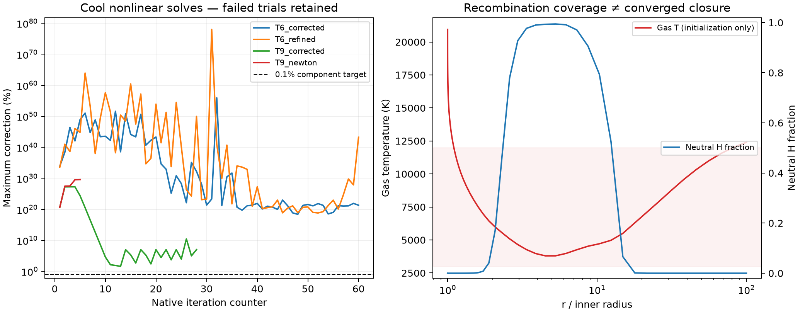

# Report 14 — cool CMFGEN recombination and material-response gate

**Outcome: BACKEND/PHYSICS BLOCKER. A physical quasi-star envelope cannot yet
select a validated conservative escaping wind in QStarS.** The immediate
blocker is a finite, converged cool non-LTE temperature/population/radiation
response. The tested cool controls fail nonlinear and independent energy
checks; a full Newton continuation develops a radiation-moment instability.
This is a failure of the current implementation/validation path, not proof
that a physical 1D quasi-star wind does not exist. QStarS remains **0.1
development, not v1**.

No physical envelope was attached. No production mdot, sonic solution, coupled
evolution, complete published evolutionary track or QSRD run was claimed.
Those tasks depend on the failed cool-closure gate.

## Work completed

1. Added explicit cool H/He component controls with H−, two-photon processes
   and Rayleigh scattering, retaining native full atomic levels, non-LTE
   transfer, level dissolution and the prior conservation thresholds.
2. Found and repaired two defects in the selected public CMFGEN source: wrong
   population output indices with H− present, and wrong neutral-H selection,
   array stride and population derivative in the Rayleigh path.
3. Implemented the ideal resolved-atom material differential, including
   excitation, ionization, H− detachment, electron creation and pressure work.
   It exposes population derivatives and explicitly withholds a relaxed
   non-LTE EOS/sonic certificate.
4. Added explicit rejection of nonfinite native diagnostics. The T9 trial
   printed NaN luminosities followed by a zero nonlinear correction, then
   crashed; a zero correction is not accepted as convergence.
5. Retained setup failures, transfer instabilities, initial guesses, restart
   trials, spectra, correction histories, source/atomic hashes and the
   independent analyses. Thresholds were not increased and no physical
   coefficients were fitted.

The final native-enabled regression run passes **117 tests, zero failures,
zero skips, in 63.37 s**. The earlier full run passed 115 before the two
nonfinite-rejection regressions were added. These timings include concurrent
work and are not isolated performance comparisons.

## Physics and reference scope

The [declared protocol](../benchmarks/cmfgen_cool_validation_plan.json) and
[numerical recovery plan](../benchmarks/cmfgen_cool_recovery_plan.json) retain
the 0.1% nonlinear-correction, 1% electron-balance, 0.1% radiation-energy and
1% profile-refinement targets. At least three cells must have 3000–12000 K
gas and 10–90% neutral hydrogen before a case counts as recombination coverage.

[Martins, Schaerer & Marques-Chaves (2026)](https://arxiv.org/html/2605.12141v1)
motivates the T9/T6 luminosity, radius and prescribed mass-flux scales. Their
metal-bearing models use an adjusted deep atmosphere and a prescribed flow;
they do not establish mass-loss self-selection. This campaign uses X=.7/Y=.3,
no metals and an explicitly specified beta-one flow with a 0.01 km/s base
speed. It is a primordial component stress test, **not a reproduction of their
published atmosphere profiles or a physical envelope**. No unreported base
scale height is fitted.

The controls contain H− plus 30 HI, 69 HeI and 30 HeII full levels and stripped
ions. Scattering is coherent in the current energy interface. The 50 km/s
line-width parameter supplies no convective or turbulent stress/energy model.
Molecules and nonideal material free-energy terms are absent. Native level
dissolution remains enabled and needs a consistent thermodynamic assessment.
The supplied H− collision input is explicitly a guess; neither its small
population nor the successful software build certifies its opacity/rate effect.

Initial controls solve prescribed-flow statistical/radiative equations with
material and population advection disabled. Their temperature must actually
be released and converge before claiming radiative equilibrium. A wind would
add and independently validate both advection terms. No fixed-temperature
Lambda sequence is labelled a solved thermal atmosphere.

## Native repairs and independent tests

The [read-only output repair](../backends/cmfgen/population_export.patch) selects
ions by name instead of fixed indices. With identical inputs, its matched
one-iteration control has byte-identical spectra, H−/HI/HeI/HeII departure files
and cooling output; every common material/radiation array is identical at
printed precision. See [the invariance record](evidence/cool_20260929/population_export_invariance.json).
Both sides of this comparison retain the same original Rayleigh defect; this
check certifies output invariance only.

The [Rayleigh repair](../backends/cmfgen/hminus_rayleigh.patch) changes no
cross-section coefficient. It supplies neutral HI to the opacity routine,
uses HI's actual level-array stride and attaches the derivative to its
population equation. In a native test compiled from the actual call sites,
the original code has approximately 100% opacity/HI-derivative error for the
declared H−-containing fixture. The repaired opacity and derivative agree with
the independent low-frequency formula at displayed machine precision, below
1e−12. [Original failure](evidence/cool_20260929/rayleigh_original/validation.json)
and [repaired result](evidence/cool_20260929/rayleigh_fixed_v2/validation.json)
are retained. This does not certify the fit over every frequency or a complete
atmosphere. A compile attempt with an inherited invalid macOS deployment target
is also preserved; the working probe uses the same 14.0 target as the backend.

The native runner now gates H0 plus Rayleigh scattering on a matching repaired
build capability record, and monitors nonfinite diagnostics. Build 5's
[source and executable hashes](evidence/cool_20260929/build5.json) identify the
executed implementation. The [replay instructions](../backends/cmfgen/README.md)
and upstream license notices cover all four source patches.

## Cool convergence and energy evidence

The corrected coarse T6 run finishes 60 iterations and writes finite output,
but this is not successful nonlinear convergence:

| T6, 84 radii / 43,314 frequencies | Measured | Target | Status |
|---|---:|---:|---|
| Cool partially recombined cells | 9 | ≥3 | PASS, coverage only |
| Maximum population/charge accounting error | 6.14e−8 | 1e−6 | PASS |
| Maximum spectral moment/flux-opacity normalization error | 4.85e−8 | 2e−6 or tighter | PASS |
| Final nonlinear correction | 2.074e21% | 0.1% | FAIL |
| Native electron-balance residual | 150.59% | 1% | FAIL |
| Global independent radiation-energy defect | 8.6847% | 0.1% | FAIL |
| Largest cumulative interior radiation-energy defect | 14.8590% | 0.1% | FAIL |
| Ideal extended-state directional derivative error / P or u | 2.57e−11 | 1e−6 | PASS, material component |

The gas temperature spans 2808–13553 K; the neutral H fraction spans
1.97e−6–0.999674. The maximum H− fraction is 1.54e−12. These describe retained
unconverged output, not validated stellar structure. The native Lambda sequence
holds temperature fixed. The correction records identify large changes in
excited H/He levels; nuclei/charge conservation alone cannot certify their
non-LTE state. [Complete coarse audit](evidence/cool_20260929/T6_coarse_audit/cool_validation.json).

The corrected T9 coarse trial produces NaN luminosities at iteration 29,
reports a spurious zero correction, then exits with SIGSEGV. A fresh full-cycle
trial cannot read the native BA matrix. A separate completed one-iteration
bootstrap followed by a full Newton continuation reaches iteration 6 before
`VAR_JREL_V2` reports runaway J; the earlier moment iteration also reports an
excessive iteration count. These failures are not hidden by process exit zero,
stale RVTJ data or a last printed correction of zero.

The 167-zone T6 refinement uses geometric bisection of the same radial
intervals and the same analytic velocity field and microphysics. It completes
60 iterations with 19 partially recombined cool cells, but its final nonlinear
correction is **1.783e43%**, electron-balance residual **150.57%**, global
radiation-energy defect **1.9309%**, and maximum interior defect **6.4093%**.
It also holds temperature fixed. Population/charge accounting is within
8.90e−8 and the ideal material derivative error is 2.71e−11; those bounded
checks do not rescue the failed state. [Complete refinement audit](evidence/cool_20260929/T6_refined_audit/cool_validation.json).
The smaller radiation defect is not evidence of converged structure or a
measured convergence order: neither compared state has converged populations
and temperature. No frequency or response-step convergence is certified.



The right panel shows a T9 initialization snapshot, not an equilibrium. The
left panel omits the invalid zero correction after NaN luminosities; the raw
zero, nonfinite diagnostics and crash remain in the archive.

The independent gas first-law diagnostic is retained, but its failed-state
value is not interpreted as a physical heating demand: the final spectral
snapshot precedes the final population update, and unconverged populations
are not synchronized with that radiation field. The radiation-only cumulative
identity uses the internally consistent spectral snapshot. Its failure alone
already excludes use as a conservative QStarS source.

## Material response and the remaining coupling gate

The [material contract](../docs/nlte_cool_closure.md) specifies all coordinates,
units, energy zeros and first-law terms. With Y_a=n_a/rho and charge Z_a,

```
Pgas = rho k T sum[(1+Z_a) Y_a]
ugas = (3/2) k T sum[(1+Z_a) Y_a] + sum[E_a Y_a]
```

The implementation supplies exact partial derivatives at fixed populations
per gram and derivatives with respect to the population vector. Tests check
ionization/excitation, negative-ion binding, electron creation, nuclear
conservation, energy-gauge cancellation and the LTE-limit population chain
rule. It includes neither radiation energy nor radiative mechanical work a
second time in gas heating. It does not reuse LTE FreeEOS/MESA derivatives for
the non-LTE state.

**What remains is the relaxed, nonlocal material/radiation response.** Changes
to density, temperature and velocity alter populations and radiation at other
radii. The population chain-rule terms must be combined with a converged
rate/transfer Jacobian, consistent level-dissolution/nonideal energy and a
validated shared envelope energy/mass convention. None of those requirements
is closed by a frozen-population heat capacity. Differencing the failed native
solutions would manufacture a noisy response, so no such response is passed
to the wind eigenvalue solver.

The convection-to-wind handoff is still unsupported. CMFGEN's radiative
atmosphere supplies no convective flux, turbulent stress or dissipation law.
Matching must retain those terms or demonstrate an overlap in which they are
negligible within a declared error budget. No such overlap follows from the
failed cool controls. The **Mach-one MLT guard stays enabled** and passes its
regressions. No cap, porosity coefficient or line width is used to force a
match. Global mdot selection, a sonic branch and escaping-envelope conservation
remain downstream of these failed prerequisites.

## Release decision and reproducibility

The [v1 matrix](evidence/completion_gates.json) remains FAIL for production
wind, full published evolution, cross-validation and QSRD readiness. Bounded
component PASS results do not change that decision. The current request's
[gate matrix](evidence/cool_20260929/gate_matrix.json) distinguishes them:

| Gate | Status | Evidence boundary |
|---|---|---|
| Cool partially recombined coverage | PASS | 9 / 19 cells; coverage only |
| H− output and Rayleigh implementation repairs | PASS | Matched output invariance and native analytic fixture |
| Cool non-LTE thermal/population/energy closure | FAIL | Coarse and refined failures; T9 NaN and Newton instability |
| Thermodynamic material/radiation response | CONDITIONAL | Ideal extended-state partials pass; relaxed response unvalidated |
| Global nonlocal mdot/sonic eigenvalue | FAIL | No valid cool response to couple |
| Conservative convective handoff | FAIL | No overlap or stress/transport/dissipation closure |
| Physical envelope selecting an escaping wind | FAIL | Prerequisites failed; not attempted |
| Coupled evolution / complete published track | FAIL | Prerequisites failed; not attempted |
| Cool mesh/frequency/response convergence | FAIL | No pair of converged equilibria |
| Failure rejection and evidence preservation | PASS | NaN regression, failed runs and verified archives |
| Apple Silicon / cloud readiness | CONDITIONAL | Local components measured; global and Linux costs unknown |
| General QStarS v1 / QSRD | FAIL | Independent release gates remain open |

All **13 native trials** appear in the [campaign summary](evidence/cool_20260929/campaign_summary.json),
including setup failures and diagnostic-only controls. The
[native archive index](../benchmarks/results/2026-09-29-cool/archive_index.json)
verifies **1,155 selected files**. Another **937 intermediate files**, including
large spectra and Jacobians, remain local and are explicitly hashed; atomic
data links are recorded separately. Original results were not overwritten.
The [metadata erratum](evidence/cool_20260929/input_metadata_erratum.json)
corrects an inherited descriptive JSON field without changing any native
input or original evidence. Actual VADAT/MODEL_SPEC/RVSIG_COL and cool-control
records establish the executed H− configuration and flow.

The final [interface snapshot](evidence/cool_20260929/interface_source.zip) and
[manifest](evidence/cool_20260929/interface_manifest.json) preserve the code,
patches, plans, tests and documentation. Each component audit also carries its
own source snapshot; earlier audit drivers are retained as executed. The
[historical runner/adapter archive](evidence/cool_20260929/historical_interfaces.json)
matches every native run's recorded hashes. The new live NaN guard is not
retroactively attributed to trials launched before it existed. The
[release verification](evidence/cool_20260929/release_verification.json) records
the hash checks, 117-test regression result and CLI result. The CLI reports
29 of 31 checks passing, preserves the two CB24 discrepancies, and exits 2
with `--require-v1`. The source registry now contains 56 entries.

## Local compute and cloud decision

On the Apple M5 / 16 GiB MacBook, the corrected 84- and 167-radius T6 controls
take **1041.17 s / 2008.61 s** (17.35 / 33.48 min), with peak footprints
**121.75 / 181.69 MiB**. The failed T9 Newton continuation takes **331.47 s**
and **543.09 MiB**. All 13 per-process wall times sum to **4849.26 s**;
overlapping cases mean this is not campaign elapsed time. These measurements
include concurrent work and are not isolated scaling benchmarks.

The failures occurred without resource exhaustion. A larger machine would
not certify the current invalid closure, so no cloud run was needed to decide
this gate. No atomic levels or required processes were removed to fit local
hardware. A future converged full-metal/global-response campaign may need
cloud CPU and memory; Linux agreement, scaling and physical-wind/evolution
cost remain unmeasured. See the [performance report](../docs/performance.md).

The exact next blocker is a stable, finite, thermally converged cool
rate/transfer solution with independently converged radiation energy and
internal populations. Only then can its population-energy/force response be
validated, coupled globally to the wind eigenvalue, and matched conservatively
through the convective transition. The evidence supports repairing that
numerical/physical closure; it does not support prescribing mdot and calling
the resulting flow a selected wind.
