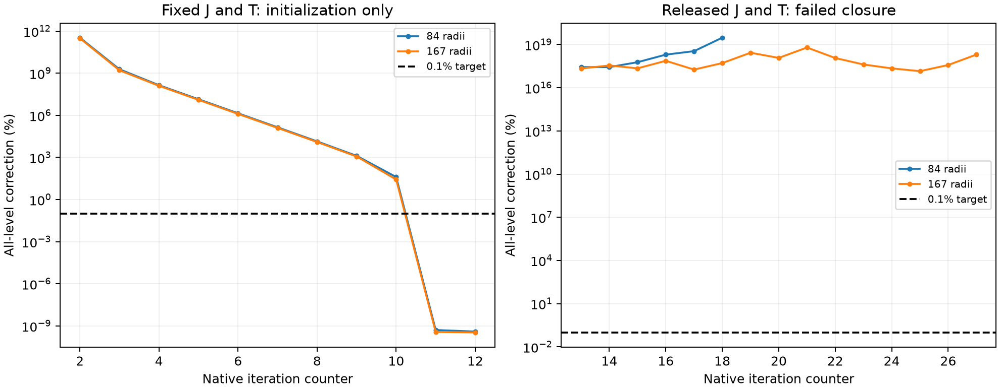

# Report 15 — cool rate/transfer recovery and isolated radiation failure

**Outcome: NUMERICAL BLOCKER. QStarS cannot yet determine a validated escaping
wind and its mass-loss rate from a physical quasi-star envelope.** Native
H-minus free-free defects and a stopping blind spot are repaired. Fixed-field
cool population initialization now completes on two meshes, but the joint
released population/temperature/radiation closure remains invalid. QStarS
remains **0.1 development, not v1**.

The remaining demonstrated blocker is the moving-frame frequency-coupled
radiation-moment solution in the cool recombining control, together with its
nonlinear rate response. Negative moment intensities appear just below the
He I ground continuum edge; a retained recurrence later amplifies radiation
inherited from the preceding frequency to enormous values. Independent linear
algebra reproduces those native solutions. This is not a physical nonexistence
result and does not establish that every alternative discretization fails.

No failed response was coupled into the global mdot/sonic operator. No physical
envelope wind, convective handoff, coupled evolution, full published track or
QSRD campaign was claimed. The Mach-one MLT guard remains active.

## Declared scope and unchanged physical inputs

The [recovery plan](../benchmarks/cmfgen_cool_rate_recovery_plan.json) retains
0.1% nonlinear correction, 1% electron balance, 0.1% global and cumulative
radiation energy, and 1% internal-profile refinement targets. Three cells with
3000–12000 K and 10–90% neutral H are required for recombination coverage.
Passing endpoint radius or luminosity cannot certify the internal state.

The T9 primordial component retains X=.7/Y=.3, H-minus plus 30 HI / 69 HeI /
30 HeII full levels, native dissolution and atomic data, two-photon processes,
Rayleigh and coherent electron scattering, radiation advection and relativistic
terms. It retains the prescribed beta-one component flow, radius, luminosity,
base speed and mass flux from Report 14. Those inputs test a closure; they are
not production mdot or a physical-envelope wind. No opacity/rate multipliers,
removed required processes, temperature floor or fitted coefficients were used.
Material/population advection is still excluded from this initial equilibrium
component; a wind would require both, independently audited.

Fixed J and T are initialization only. MAX_LAM=10, MAX_LIN=2, MAX_dT=.05 and
full-cycle/BA controls are numerical step choices. The additional LAM_VAL=1e99
trial suppresses automatic Lambda switching; it does not change an atomic or
physical coefficient. Native first-cycle setup still holds T once after the
fixed-field checkpoint. Later full cycles release it. None of these numerical
choices is certified by a failed trajectory. T9/T6 reference scales remain
component stress controls, not a published-model reproduction.

## Native defects repaired and tested

The [FF patch](../backends/cmfgen/hminus_ff.patch) changes no tabulated
coefficient or interpolation:

1. `DO_H0_FF_COOL` accessed unallocated tables when cooling was the first entry.
   A debugger locates the null access in that routine; the original isolated
   native probe reproduces SIGSEGV. Shared lazy initialization repairs both
   independent entry points.
2. `GENOPAETA_V10` evaluated depth one in its last-depth-only H-minus branch.
   It now evaluates the actual final depth, with the scalar call length one.
3. `VAR_OP_V10` used the charged-ion Z² formula for H-minus, omitting its
   free-free opacity/emissivity derivatives. The repair differentiates the
   actual log-table coefficient and Planck function with respect to T, electron
   density and neutral-H ground population.
4. `COMP_FREE_FREE_V2` accessed `GFF_STORE(:,0)` in its H-minus EHB Jacobian.
   A bounds-checked original native probe fails there. The repaired branch uses
   the same ground-H population and derivatives as opacity and cooling; it no
   longer inconsistently sums excited neutral levels for this process.

Native SOLVEBA stopping can discard ten largest corrections when the remaining
levels are small. The original fixed-J trial reports **4.80e−10%** while its
largest raw level correction is **40.3%**. This is an intentional native stopping
heuristic, not proof of complete rate convergence. QStarS's patched criterion
keeps all levels; the independent audit also checks raw corrections, including
unpatched historical runs. The [historical erratum](evidence/cool_recovery_20260929/historical_correction_erratum.json)
changes interpretation, not the old files. Report 13's bounded hot 0.1%
nonlinear PASS results remain below that threshold under the stricter reading.

The [native probe](../scripts/check_cmfgen_hminus_ff.py) compiles actual native
FF sources. Bound-free is isolated to zero only in this FF regression, never
in a scientific run. At 3300 / 6100 / 11300 K and four frequencies:

| Check | Repaired error | Target | Result |
|---|---:|---:|---|
| Cooling-first vs opacity-first entry | 0 | 1e−6 | PASS |
| All-depth / last-depth opacity path | 0 | 1e−6 | PASS |
| Kirchhoff emissivity and native cooling identity | 2.22e−16 | 1e−6 | PASS |
| Ground-H and electron partials vs finite differences | 1.83e−11 | 1e−6 | PASS |
| T partial vs finite differences | 1.86e−7 | 1e−6 | PASS |
| EHB opacity and derivative consistency | 0 | 1e−6 | PASS |

[Original native failures](evidence/cool_recovery_20260929/ff_original_full/validation.json)
and [repaired results](evidence/cool_recovery_20260929/ff_fixed_full/validation.json)
are retained. The normal opacity/emissivity/cooling path is unchanged at
16-digit printed precision in all four matched fixtures; see the
[invariance record](evidence/cool_recovery_20260929/ff_invariance.json).
These certify a bounded FF implementation, not its full tabular accuracy,
all atomic rates, an entire thermal Jacobian or a relaxed material response.

## Population initialization and released failures

The repaired fixed-J/T runs reach native counter 12 with largest corrections
**3.94e−10% (84 radii)** and **3.42e−10% (167 radii)**. They contain respectively
**5 and 11** cool partially recombined cells. Printed hydrogen/helium/charge
accounting errors are below **7.38e−8**. Their gas temperatures span about
3782–20951 K. See the [population audit](evidence/cool_recovery_20260929/fixedJ_population_audit.json).
These are settled fixed-field initializations. Their dummy flux and held
thermal state prohibit radiation-energy or thermal-equilibrium certification.

The original 84-radius released trial fails at counter 19 after a last complete
correction near **3.01e19%**. The numerical full-cycle control also fails at
counter 19. The runner detects missing fresh RVTJ; its retained native log
states that the mean intensity is blowing up. Fortran exit zero is not a pass.
The **167-radius** released solve stops at **counter 28**, reporting poor inner
flux accuracy and some normalized luminosities wrong by a factor of two.
Its last complete all-level correction is **2.013e18%**, and no fresh final
RVTJ is produced. It takes **1727.13 s**, with **1147.13 MiB** peak footprint.
It ends through native diagnostics, not the 2400-second runtime limit or
resource exhaustion. All measured cases are listed in the
[campaign summary](evidence/cool_recovery_20260929/campaign_summary.json).
Neither fixed-field agreement nor a failed refined trajectory establishes
mesh convergence of an equilibrium or any convergence order.

Fresh synchronized populations, T, electron balance and independent radiation
energy have not passed together. The failed released cases have no fresh
complete final RVTJ/spectral pair. Their inherited snapshots are not audited as
final equilibria. Consequently no radiation-energy PASS or converged relaxed
response is inferred from them.

## Radiation failure attribution

The first crashing population case uses Report 14 build 5. Build 6 adds
read-only MOM/VAR failure operators; build 7 adds the FF and
stopping repairs; build 8 adds read-only high-J recurrence/fatal-state captures.
The [source/build records](evidence/cool_recovery_20260929/build8_final.json)
and patch manifests identify every changed file. Native clipping, stopping,
angular treatment and transport coefficients are unchanged by instrumentation.

The [captured original moment/variation operators](evidence/cool_recovery_20260929/moment_trace_analysis_v2/analysis.json)
have positive absorption in every row. An independent SciPy band solve agrees
with native THOMAS within **1.88e−16**. Componentwise backward residuals are
below **1.64e−16**. One moment RHS is negative and produces a negative intensity,
which native code replaces with the formal-ray value. Its photon-advection
fixed-point error is **4.705e4** after 100 iterations. Native code then sets its
accuracy flag and continues; that behavior cannot certify QStarS closure.

A labelled restart from the repaired, failed coarse checkpoint captures the
later runaway. The [earliest retained negative-J diagnostic](evidence/cool_recovery_20260929/edge_attribution.json)
is at nu=5.9418253e15 Hz, **0.0568% below** the He I ground threshold at
5.9452e15 Hz. This locates the numerical failure near a sharp continuum edge;
it does not prove that a He I rate or cross section is wrong. He I remains
present with all declared processes.

At nu=5.882652614e15 Hz, the [growth operator](evidence/cool_recovery_20260929/growth_analysis_v3/analysis.json)
gives a raw maximum physical J of **2.644e66**. The independent linear solution
agrees within **1.54e−16**, with componentwise residual **2.01e−16**. The
interior RHS decomposition closes within **3.22e−16**; the local material source
is only **3.06e−75** of its RHS norm. The huge inherited frequency-coupling terms
already dominate before the linear solve. Positive current absorption and an
accurate linear solve do not make that recurrence a valid radiation field.

Two matched one-iteration diagnostics test the same failed material checkpoint
with freshly initialized angular/scattering iteration, then with numerical
frequency refinement from **43,314 to 85,359 frequencies**. Atomic data,
physical smoothing/line widths, velocities, populations, T, density, luminosity,
mass flux and frequency endpoints are unchanged. Both still fail, taking
**28.16 / 55.21 s**. The finer-frequency fatal state reaches J≈**6.02e221**
at nu=5.943370801e15 Hz. Its [fatal-state record](evidence/cool_recovery_20260929/frequency2_analysis_v3/analysis.json)
contains no captured complete raw operator, so no independent linear-solve
agreement is claimed for that particular case. These are failure-attribution
controls, not a pair of converged frequency refinements. Reinitializing the
radiation seed and this level of frequency refinement do not rescue this
checkpoint; no universal no-convergence claim follows.

The necessary next repair is a stable, conservative frequency/spatial moment
closure across that edge, with a matching nonlocal linearization, followed by
the fully released nonlinear and mesh/frequency tests. These snapshots do not
alone establish which earlier angular/frequency term first seeds growth or
validate a proposed replacement stencil. Switching to a clipped Eddington
prescription, deleting He I/advection, or copying a frozen J would not close
the gate. No such bypass is used here.

## Material response, conservation and gate decision

The [material contract](../docs/nlte_cool_closure.md) retains excitation,
ionization, electron creation, H-minus binding and pressure work. The new FF
partials close a real piece of the native response. They do not supply
`dY/dlnT`, `dY/dlnrho`, velocity/boundary response or the relaxed nonlocal
material/radiation Jacobian. Native dissolution consistency and the supplied
guessed H-minus collision rates also remain validation requirements. No LTE
EOS derivatives are grafted onto an unconverged non-LTE state.

| Campaign gate | Status | Evidence boundary |
|---|---|---|
| Cool partially recombined coverage | PASS | 5 / 11 fixed-field cells; coverage only |
| Native FF entry/opacity/derivative repairs | PASS | Matched native fixtures and original failures |
| Complete fixed-J rate initialization | CONDITIONAL | All correction and particle checks settle; J/T are held, rates lack independent full-atom certification |
| Released cool populations/T/radiation/electron/energy closure | FAIL | Retained nonlinear/radiation failures; no synchronized energy certificate |
| Internal mesh/frequency convergence | FAIL | No pair of converged thermal solutions |
| Relaxed material/population/radiation response | FAIL | Ideal partials and FF derivatives only |
| Global self-selected mdot/sonic solution | FAIL | Invalid prerequisite response; coupling withheld |
| Conservative convective-envelope handoff | FAIL | No validated overlap/stress/energy closure; MLT guard retained |
| Real-envelope escaping wind / evolution / full published track | FAIL | Prerequisites failed; not attempted |
| Failure/provenance safeguards | PASS | Failed states, explicit corrections and imported-code erratum retained |
| General QStarS v1 / QSRD | FAIL | Independent gates remain open |

The [machine-readable campaign matrix](evidence/cool_recovery_20260929/gate_matrix.json)
and [general v1 matrix](evidence/completion_gates.json) preserve those boundaries.
This is **NUMERICAL BLOCKER**, not one-assumption CONDITIONAL and not
SELF-SELECTED WIND PASS.

## Reproducibility and performance

All 13 native cases, including the debugger crash and failed-checkpoint diagnostic,
are retained. The archive preserves inputs, restart state, logs, corrections,
operator captures and atomic link hashes; large spectra/matrices remain hashed
local assets. The [verified archive](../benchmarks/results/2026-09-29-cool-recovery/verification.json)
contains **1285** selected files; **2092** intermediate files remain explicitly
hashed local assets. Twelve measured trials total **2866.01 s** of process wall
time; the debugger has no comparable timing, and overlapping cases make this
sum different from campaign elapsed time. No failure directory was overwritten. The
[loaded-code erratum](evidence/cool_recovery_20260929/loaded_code_hash_erratum.json)
identifies the actual imported runner/adapter in the three-stage refinement
process: later on-disk hashes had changed while Python still used its original
imports. Original manifests remain unchanged. Future runners record import-time
hashes, and a regression checks this case. The completion guard excludes old
failure messages only when the preserved inherited log prefix matches both
the manifest hash and the current bytes; new radiation failures still reject.
Another regression verifies that an unattested prefix cannot hide failure. Historical source snapshots are
matched to those actual versions; newer safeguards are not retroactively
assigned to old runs. An [analysis erratum](evidence/cool_recovery_20260929/analysis_interpretation_erratum.json)
corrects historical growth-header interpretation and the empty-operator
frequency diagnostic; the corrected records linked above define the claims.

The final native-enabled regression suite passes **122 tests, zero skips, in
51.91 s**. An earlier ABI-5 test run with one skip is preserved; the final run
uses MESA bridge ABI 6 and direct FreeEOS. CLI validation still correctly exits
2 with 29/31 checks passing and the two retained CB24 discrepancies. The source
registry now has **57** entries. Software regression PASS does not certify cool
closure or wind physics.

The Apple M5 / 16 GiB MacBook completes the repaired fixed-J initializations
in **20.43 / 43.37 s**, with all declared atomic levels and physics retained.
The [performance measurements](evidence/cool_recovery_20260929/campaign_summary.json)
include the failed released/refined workloads; concurrent timings are not
isolated scaling benchmarks. Resource exhaustion did not cause the captured
coarse radiation instability. More CPU cannot repair that recurrence. Linux
agreement and production-wind/evolution cost remain unmeasured; no cloud result
is claimed. A future valid closure/refinement campaign may benefit from cloud
CPU, but no physical model was reduced to stay local.

The [release verification](evidence/cool_recovery_20260929/release_verification.json)
links the final source snapshot, native builds, archive, regression and CLI checks.
