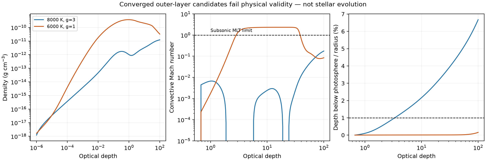

# Report 8 — Outer-boundary validation establishes a v1 release blocker

Assessment: 2026-09-28 UTC. Software: **0.1.0 development, not v1**.

The latest request permits stopping at a specific scientifically defensible
blocker. This campaign establishes one: **the implemented production-boundary
candidate converges numerically but violates its physical assumptions in
representative low-gravity quasi-star outer layers.** Substituting mature EOS,
opacity and convection libraries does not remove the conflict. Promoting it
would require ignoring supersonic MLT or extended geometry, or introducing an
unvalidated replacement closure. QStarS cannot currently make the requested
general-purpose v1 claim.

This is a release blocker for the demonstrated implementation, **not a proof
that quasi-stars cannot be modeled in 1D**. The unresolved cavity, wind and
published-track requirements are not waived. QSRD remains deferred.

## Work delivered

- MESA bridge ABI 5: native gas-pressure inversion, fixed/varying Eddington
  atmospheres, Henyey and ML1 with native automatic derivatives, and radiative
  opacity with an explicitly supplied EOS electron state. Older ABI 3/4
  EOS/opacity capabilities remain readable; native MLT derivatives require ABI 5.
- Direct FreeEOS 3.0.0 EOS1 reference, independently built on Apple Silicon;
  its gas EOS and ionization are used with MESA opacity. No fitted substitute
  EOS or silently stitched energy zero is introduced.
- Finite-pressure grey/MLT outer-layer integrator retaining density, pressure,
  temperature, opacity, convective velocity, actual radiative force and layer
  mass/energy inventories. It is deliberately not promoted to evolution.
- A new evolution validity screen rejects inconsistent dilute gas pressure,
  independently of radiation-dominated total-energy checks.
- Component audits, atmosphere sensitivity campaign, regression tests,
  performance measurements, source registry and archived failures.

The [physics documentation](../docs/atmosphere.md) contains equations,
assumptions, dependency/build commands and exact resolution criteria.

## Quantitative blocker evidence

**Native starting-pressure prescription.** MESA's varying T(tau) reference
starts from rho=1e-10, not zero gas pressure. At Teff=8000 K, g=3 cm/s² and
constant kappa=0.34, the photospheric gas pressure is 56.6504 dyn/cm² versus
0.717479 in its analytic vacuum solution: **78.9576 times larger**. At 6000 K,
g=1 the ratio is 129.449. At solar gravity it is 1.000742. This is a physical
boundary-condition difference, not a native integrator failure.

**Low-density ionization.** The expanded 77-state MESA audit has 60 neutral
fallback states. At rho=1e-16 and T=6000 K, the default returns free_e=1.66e-28;
direct FreeEOS gives 0.68785 and 99.033% hydrogen ionization. Consistently using
those electrons changes the same opacity library's value from 6.65e-29 to
0.27555 cm²/g. Native pressure initialization alone would not cure this.

**Gas pressure hidden by radiation.** At rho=1e-9 and T=1e6, the historical
MESA EOS passes the total first-law test at 1.04e-8 but differs from the
dilute gas-pressure limit by **8.282%**. Direct FreeEOS gives Pg=134193.864
versus MESA's 145307.689 dyn/cm². Its radiation-scaled offset is consistent
with a historical radiation subtraction mismatch, but the original table
generation metadata do not prove that cause. No fitted correction is used.
MESA's separate table-loader floor free_e>=1e-4 is also recorded explicitly.

**The replacement atmosphere still fails.** With direct FreeEOS, matched
MESA opacity, explicit external pressure and native MLT, both reference
branches integrate. For enclosed mass 10000 Msun:

| Test | 8000 K, g=3 | 6000 K, g=1 |
|---|---:|---:|
| Photospheric gas pressure, dyn/cm² | 1.26632 | 142.148 |
| Photospheric density, g/cm³ | 1.3644e-12 | 3.6855e-10 |
| Depth from photosphere to tau=100 / radius | **6.676%** | 0.1574% |
| Maximum Henyey convective Mach | 0.175631 | **2.336716** |
| Maximum ML1 convective Mach | 0.175624 | **2.336716** |
| Optical depth at peak Mach | 100 | 19.7878 |
| Blob optical depth at peak Mach | 206.0 | 1596.2 |
| Maximum radiative Eddington factor | 1.11745 | 7.75768 |
| Layer mass / enclosed mass | 7.565e-5 | 2.148e-4 |

The warm layer violates the plane-parallel assumption even below the
photosphere; g and flux vary by order 13% over that depth. The cool model
requires pressure-equilibrated MLT blobs moving at more than twice the sound
speed well inside an optically thick region. A density inversion or
super-Eddington luminosity alone is not used as the failure criterion.

Tightening integration rtol from 1e-7 to 1e-9 leaves these failures unchanged.
Maximum gas-pressure/density log-profile differences are below 2.12e-5.
Changing the outer pressure to 1 dyn/cm² reduces the cool layer's thickness,
but its Mach number remains **2.33224**. Changing to constant opacity removes
the cool convective failure while drastically changing density; that would
discard the required recombination physics rather than validate it.

## Numerical and conservation evidence

| Check | Evidence | Scope |
|---|---|---|
| Direct FreeEOS gas first law, 153 states | max 1.008e-7 | Gas-only check; radiation cannot mask error |
| Gas derivative audit | max 1.991e-6 | Finite difference versus native derivative |
| Gas-pressure/density inverse | max 2.232e-14 relative | Sampled states only |
| Constant-opacity grey Pg | error <9.3e-9 | Independent analytic boundary solution |
| Tight-tolerance integrated hydrostatic balance | 9.45e-13 warm; 9.03e-10 cool | Does not certify physical validity |
| Current regressions | **62 passed**, 7.33 s | MESA and FreeEOS enabled |
| Base installation | **48 passed, 14 skipped**, 6.00 s | Optional libraries absent |
| CLI scientific checks | 29/31 pass; `--require-v1` exits 2 | Two retained CB24 printed-value discrepancies |
| Fresh MESA 128-zone ten-year run | 500 steps, zero retries | Controlled hot envelope, not production track |
| Fresh mass and energy accounting | mass residual zero; energy/throughput 3.45e-11 | Independent QStarS ledger |
| Fresh MESA state and ledger versus Report 7 | **bitwise equal** | Every checkpoint field except path-bearing config |

The earlier controlled 256/512/1024/2048-zone campaign remains the spatial
evidence. Maximum local internal-profile errors are 0.250% for 512 versus
2048 and 0.0803% for 1024 versus 2048. The 256-zone internal-energy error
still exceeds 1%. Reducing dt from 0.02 to 0.005 years changes 512-zone
pressure by 0.0757%; refined midpoint versus backward Euler differs by less
than 0.81%. Bitwise restarts and conservative remapping are retained. These
hot-envelope results **do not certify production atmosphere/cavity/wind
evolution**, for which no converged full track exists.

FreeEOS's five upstream byte-for-byte tests remain **FAIL** on this platform.
The first upstream physical-state fields agree within 1.44e-14 scaled error;
full finite-difference diagnostic streams are not asserted to match. The
separate QStarS gas-only tests quantify the sampled working domain. A build
success is not reported as full upstream validation.

## Complete published benchmark status

This table inventories the requested benchmark families; it is not a claim
that the unimplemented tracks have been supplied.

| Family | Executed or available evidence | Full evolution status |
|---|---|---|
| Ball/STARS | n=2/3/4 static BH fractions 0.126753/0.101515/0.088521; published Table 1 targets stored | **FAIL** — moving cavity and complete tracks absent |
| Fiacconi–Rossi | Stationary advective wind; 349/461 Figure 4 vertices inside stated band; discrepancies preserved | **FAIL** — wind/envelope/atmosphere evolution not coupled |
| Dotan et al. | Explicit launch/tiring law and separate wind ledger | **FAIL** — porous atmosphere and fed/wind tracks absent |
| MESA-QUEST / Santarelli | Pinned source, startup experiments and failures retained; equation-11 luminosity law | **FAIL** — no completed upstream or QStarS quasi-star track |
| Hassan et al. | Corrected cavity/Bondi cubic reference | **FAIL** — evolving corrected boundary and tracks absent |
| Roman-Garza et al. | Source/assumptions audited; prescribed net-gain and late extrapolation distinguished | **FAIL** — not reproduced |
| Coughlin–Begelman | Corrected Bondi and saturated static families; printed-cutoff disagreement retained | Static evidence only; no evolution inferred |
| Cantiello et al. | Stability assumptions/source audited | No nonadiabatic stability replica; solver failure is not instability |
| Non-LTE atmosphere literature | 1D spherical expanding atmosphere assumptions audited | Not implemented or claimed as stellar evolution |

**Complete evolutionary replicas: zero. Cross-paper evolutionary prediction
without retuning: zero.** Radius, Teff, L, BH/envelope growth, accretion, wind,
lifetime and profiles have not been compared together for several full
published tracks. Their missing comparisons cannot be supplied by static
agreement. Machine-readable entries are in the
[benchmark manifest](../benchmarks/manifest.yaml).

## Original completion-gate matrix

PASS certifies only the stated implemented scope. CONDITIONAL is not a
general-use certification; FAIL remains a release blocker.

| Original gate | Status | Evidence or boundary |
|---|---|---|
| 1. Sourced/derived equations and boundaries | PASS | 30-entry registry and explicit atmosphere derivation; missing closures not asserted |
| 2. Quantified mass/energy conservation | CONDITIONAL | Hot ledger passes; moving cavity and atmosphere inventories not coupled |
| 3. Conservative retry/remesh/restart/timestep handling | CONDITIONAL | Controlled campaigns and regressions; production-family coverage absent |
| 4. Representative temporal/spatial convergence | CONDITIONAL | Quantitative hot internal profiles; production evolution missing |
| 5. Several independent published results | FAIL | Static subsets only; full-evolution criterion unsatisfied |
| 6. Explicit traceable prescriptions | PASS | Named alternatives, native constants, boundary inputs and disagreements visible |
| 7. Thermal quasi-star evolution | CONDITIONAL | Finite hot-envelope evolution with BH growth; lifecycle unvalidated |
| 8. Independent feeding and wind | CONDITIONAL | Separate budgets work; predictive coupled wind absent |
| 9. Identify assumption breakdown | CONDITIONAL | New gas-pressure and atmosphere counterexamples; not exhaustive production coverage |
| 10. Reproducible inputs/source/version | CONDITIONAL | Fresh source snapshots, library hashes and archive verification; historical caveats retained |
| 11. Useful individual MacBook runs | CONDITIONAL | Controlled and component costs measured; production-track costs unknown |
| 12. External QSRD configuration | FAIL | Correctly deferred until independent v1 |

For the latest request's order: **outer atmosphere FAIL; evolving cavity
FAIL; coupled wind FAIL; multiple full tracks FAIL; cross-paper prediction
FAIL; production convergence FAIL; performance CONDITIONAL; v1 release FAIL.**
The earlier nine-priority matrix and the latest eight-priority matrix are
both preserved in [completion_gates.json](evidence/completion_gates.json).

## Supported physics and performance

The evolution solver supports fixed-excision, fixed-composition Newtonian
hot envelopes, analytic or screened MESA EOS, finite thermal storage, the
documented luminosity prescriptions, separate effective feeding/wind channels,
ledger and checkpoint/retry/remap machinery. Static Bondi/saturated families,
stationary radiation-advecting winds, direct FreeEOS and native atmosphere/MLT
are **reference capabilities**, not full evolving model families. See
[supported families](../docs/model_families.md) and
[validity boundaries](../docs/validity.md).

On Apple M5 with 16 GiB RAM, the fresh MESA 128-zone ten-year run takes
**30.830 s / 1045.0 MiB**. The 14-case atmosphere campaign takes
**7.159 s / 527.4 MiB**. Earlier 512-zone analytic and 2048-zone convergence
workloads take 24.215 s and 408.516 s respectively. Each parameter case can
run in its own process; MESA/FreeEOS global state must not be shared across
threads. Cloud CPUs help independent sweeps and large convergence campaigns,
but cannot repair a physical closure failure. No production-track runtime
is fabricated; see [performance](../docs/performance.md).

## Evidence and exact release claim

The [archive manifest](../benchmarks/results/2026-09-28-outer-boundary/archive_manifest.json)
preserves 328 files; all byte lengths/SHA-256 checks and source ZIP checks
pass. Final atmosphere, FreeEOS audit, upstream comparison, tests and hot
verification all report unchanged package sources. Failed builds, compiler
logs, the 8/16/16 precision probe, explicit generic portability patch and
superseded composition-mismatch experiment are identified in
[build/attempt evidence](evidence/outer_20260928/attempt_notes.json).
Original local files remain intact. Cached third-party sources/binaries are
identified by hashes, not relicensed or redistributed as QStarS.

A final compatibility repair safely refuses the ambiguous MLT layouts in
exploratory ABI 4 libraries. All 62 tests pass after that repair. A fresh
ABI 5 atmosphere campaign and FreeEOS grid are **bitwise identical** to the
preceding campaign, with unchanged-source verification. Their separate
[40-file archive](../benchmarks/results/2026-09-28-outer-verified/archive_manifest.json)
also passes all SHA-256/length and ZIP checks. The
[repeat comparison](evidence/outer_20260928/final_abi_guard_repeat.json) and
[actual ABI 4 refusal](evidence/outer_20260928/abi4_safety_check.json) are retained.

Primary new evidence:

- [Native atmosphere/low-density audit](../benchmarks/results/2026-09-28-outer-boundary/20260928T035924.646752Z_outer_microphysics_audit/audit.json)
- [Final direct FreeEOS audit](../benchmarks/results/2026-09-28-outer-verified/20260928T044002.107801Z_freeeos_audit/audit.json)
- [Final 14-case atmosphere validation](../benchmarks/results/2026-09-28-outer-verified/20260928T044002.683023Z_atmosphere_reference/validation.json)
- [Upstream FreeEOS comparison](../benchmarks/results/2026-09-28-outer-boundary/20260928T042823.829545Z_freeeos_upstream_checks/comparison.json)
- [Final tests/CLI/hot verification](../benchmarks/results/2026-09-28-outer-boundary/20260928T042828.972984Z_outer_final_verification/verification.json)
- [Tests and component repeat after ABI guard](../benchmarks/results/2026-09-28-outer-verified/20260928T043954.437393Z_outer_abi_guard_verification/verification.json)
- [Bitwise repeat comparison](evidence/outer_20260928/hot_mesa_previous_comparison.json)

**Scientifically supportable claim:** QStarS is reproducible development
software with validated restricted hot-envelope numerics and audited physical
reference components. It is **not** a validated general-purpose quasi-star
evolution framework, a predictor of quasi-star lifetimes, or a QSRD science
result. A validated spherical and conservative atmosphere/wind closure that
handles the demonstrated recombination/convection regime, followed by full
published evolution and cross-validation, is required to change that claim.
