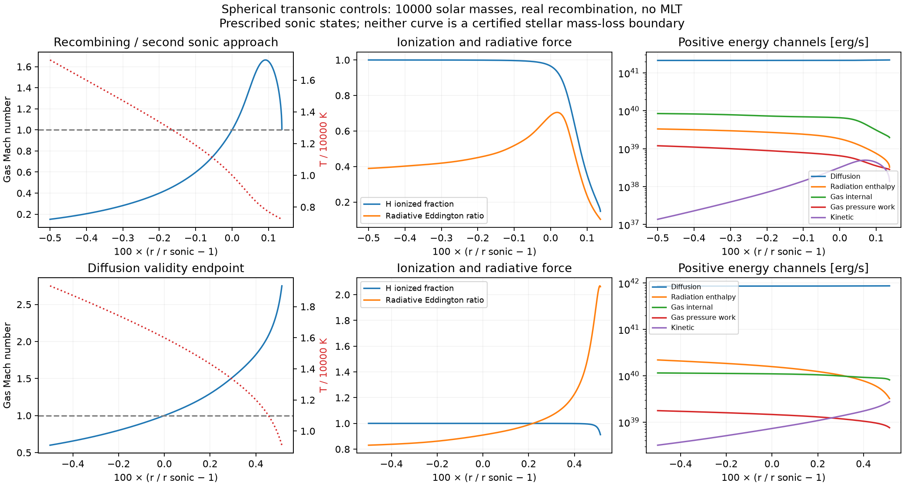
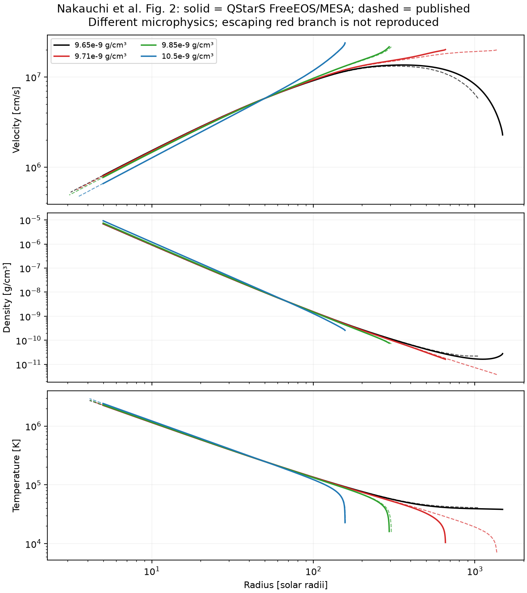

# Report 9 — Spherical transonic wind component; outer closure still incomplete

Assessment: 2026-09-28 UTC. QStarS **0.1.0 development, not v1**.

This campaign replaces the previous atmosphere-only experiment with a working
spherical gas-sonic wind **component** using direct FreeEOS and MESA opacity.
It verifies critical-point regularity, recombination, enthalpy/work transport,
base matching numerics and independent conservation identities. It does not
establish a production atmosphere/wind closure.

**Overall: FAIL / INCOMPLETE. None of the requested completion outcomes A, B
or C has been established.** Calling this B would conceal more than one open
issue: published escaping-wind replication, outer radiative transfer and a
physically validated envelope match remain open. Calling it C would turn
local/numerical failures into an unjustified general 1D no-go claim. No
coupled evolution or subsequent v1 campaign is enabled on this evidence.

## Delivered implementation

- `qstars reference benchmarks/spherical_recombining_wind.yaml` runs a new
  explicit `nakauchi2017_lte_diffusion` family. Fiacconi and Dotan retain their
  separate assumptions and coefficients.
- Spherical continuity, momentum, diffusion and total energy; real gas
  pressure derivatives and ionization energy; gas and radiation enthalpy.
- A gas sonic regularity condition and l'Hopital slope calculation. No mass
  flux coefficient or ordinary supersonic MLT is introduced.
- A matching solver takes base density, temperature and total energy flux,
  returning a sonic state and mass flux. A fixed-sphere interface separately
  returns mass, momentum, gas/radiation internal energy, pressure work,
  kinetic/potential energy and advected entropy.
- A spherical hydrostatic reference with optional enclosed-mass evolution;
  analytical and independent integral checks; 2,434 published vector samples
  with horizontal/vertical uncertainty; numerical sensitivity and retained
  failure records.
- Eight new regressions: **70 tests pass** with the pinned native libraries.
  The v1-check command still exits **2** with its historical discrepancies.

The [method audit, equations and exact domain](../docs/spherical_wind.md)
cover Nakauchi, Fiacconi–Rossi, Dotan, Quataert, Owocki, Hassan, MESA-QUEST,
multidimensional convection results and spherical CMFGEN atmospheres. Five
new primary PDFs are hashed in the acquisition record; the prescription
registry now contains 35 entries. The cached QUEST wind routine is a fitted
mass-removal prescription, not a hydrodynamic outer-boundary solver.

## Verified numerical domain

The final campaign has **22 completed component integrations**, three
successful recovery tests at different matching radii, and no failed ODE
integrations. The two Report 8 base root searches still fail their separate
matching tolerance. Completion of an integration is not successful escape.

| Check | Measured result | Interpretation |
|---|---:|---|
| Analytical spherical radiative-zero density / temperature | 3.90e-14 / 5.28e-14 maximum relative error | Geometry and diffusion verified for this analytical limit |
| Isothermal Parker critical slope | 2.73e-11 error | Independent critical-point limit; its heat reservoir is explicit |
| Worst internal-profile change across the two low-gravity controls | **6.15e-5** in log fields | Below the declared 0.001 numerical target |
| Independent first-law integral, worst refined control | **6.26e-9** relative | Below 1e-6; not just the imposed energy invariant |
| Independent momentum integral, worst refined control | **1.92e-9** relative | Below 1e-6 |
| Independent diffusion integral, worst refined control | **1.30e-7** relative | Below 1e-6 |
| Matching-slice recovery: largest mass-flux error | **1.41e-7** relative | No `mdot` input; numerical recovery only |
| Matching-slice recovery: largest base residual | **5.03e-9** in log fields | Below the 1e-5 matching target |

Refinements vary integration tolerance (1e-6 through 1e-10), maximum radial
step, output sampling, sonic start offset, critical derivative step,
independent DOP853/Radau integration, outer placement and matching radius.
Density, temperature, velocity, gas pressure, opacity, ionization, diffusive
luminosity and radiation enthalpy are compared on a common radial interval.

These targets are numerical accuracy goals: 0.1% profiles sit below the prior
1% stellar-profile goal, and 1e-6 integral errors are smaller still. They are
not empirical accuracy claims for a wind closure. Moving the radial bound
beyond a domain-exit event verifies that event's independence from the bound;
it does not verify a terminal solution at infinity.

Two numerical problems were found and repaired without changing physics:

1. Uniform output samples under-resolved the sharp recombination layer in
   conservation quadrature. Retaining and subdividing adaptive points reduced
   initial apparent first-law defects of order 5e-4 to below 1e-7.
2. An RK trial for one printed published case left the microphysics query box
   even though the accepted branch stayed inside. Retrying from the identical
   sonic state with half the maximum step completed the branch. The rejected
   state is recorded; no thermodynamic clipping is performed. The exact number
   of such trial rejections can depend on the native library's cached initial
   guesses and is not used as a physical regression invariant.

## What the recombining controls demonstrate

Both controls use M=10000 Msun, r_s=1.152e15 cm, rho_s=3e-11 g/cm³,
X=0.7, Y=0.3. They prescribe sonic states for component testing; they are
**not evolved or observationally calibrated quasi-stars**.

| Quantity | T_s=10000 K | T_s=16000 K |
|---|---:|---:|
| Stationary local mass flux, Msun/year | 8.61932 | 11.33945 |
| Termination | Approaching a second sonic point | Diffusion validity boundary |
| Endpoint temperature, K | 7228.78 | 9091.10 |
| Maximum v / local escape speed | 0.02823 | 0.05808 |
| Maximum radiation-gradient Knudsen number | 0.06374 | 0.10000 |
| Integrated shell mass / central mass | 4.15e-4 | 2.97e-4 |

In the cooler branch, the hydrogen ionization fraction falls from 0.965 at
its sonic point to 0.148 at the endpoint; opacity falls from 1.604 to 0.234
cm²/g. The branch decelerates while still within the chosen diffusion screen.
This is a calculated branch property, not a statement that all quasi-star
winds fail. **Neither tabulated local mass flux is authorized as stellar mass
loss.** No fallback evolution has been calculated.

Gas pressure is not negligible here: Pg/Pr at the two sonic states is 1.42
and 0.371 respectively. A gas-pressure-free radiation-wind approximation
cannot simply be substituted at these states. The subsonic solutions also
have decreasing entropy; setting convective flux to zero in the wind
component has not established their stability or turbulent transport.

## Published stationary comparison: still FAIL

The four Figure 2 input densities from Nakauchi et al. are used without
retuning. There are **2,194 compared vector samples**, of which **2,120** fall
within propagated plotted-stroke uncertainties. Another **240 samples lie
outside computed radial coverage**. The uncovered samples are not counted
as passing. A high point count does not excuse the key escaping-branch
failure.

For the paper's red branch (rho_s=9.71e-9 g/cm³, T_s=250000 K,
r_s=50 Rsun, M=100 Msun):

| Observable | Paper, approximate | QStarS FreeEOS/MESA realization |
|---|---:|---:|
| Mass flux, Msun/year | 0.14 | 0.135713 |
| Comparison photosphere, Rsun | 1400 | **656.64** |
| Velocity there, km/s | 200 | 201.70 |
| Escape classification | Escaping | **v/v_escape=0.837; not certified escaping** |

The original paper uses OPAL plus Alexander–Ferguson opacity and its own H/He
ionization thermodynamics. Direct FreeEOS and this MESA opacity realization
are not the original microphysics files. The discrepancy is retained; its
cause has **not** been isolated to opacity, EOS, printed parameter precision
or the original discretization. No coefficient or sonic density is adjusted
to recover the published red curve.

The comparison endpoint itself has gradient Knudsen number 0.75. It lies
outside the stricter 0.1 diffusion screen and is not a validated radiation
boundary. The previous Fiacconi Figure 4 discrepancies are also unchanged.
There is still no complete published quasi-star evolution replica.

## Envelope matching: numerical capability, physical gate open

Slices from a known wind recover its sonic state and mass flux at three
radii. This proves the matching equations execute without an imposed mass
flux; it does not validate their application to an evolving envelope.

Using the two failed Report 8 atmosphere bases as boundary experiments,
root searches leave maximum log residuals of **0.12383** (cool) and
**1.69e-4** (warm), above the declared 1e-5 target. The warm search reaches
its evaluation budget. An additional continuation encounters a trial sonic
state with complex slopes. These are retained numerical/local-branch
results, **not proofs of a global lack of roots**. The cool optimizer moves
toward its lower sonic-radius bound, which also does not prove nonexistence.

FreeEOS's energy zero is the diatomic hydrogen ground state. A constant
energy offset cancels inside a single stationary ODE solution but not from
an externally supplied total energy flux. The eventual evolving-envelope
match must verify the same energy gauge and moving-face work on both sides.
The failed hydrostatic atmosphere's luminosity is not by itself that audit.

## Outer campaign gate matrix

| Gate | Status | Evidence / boundary |
|---|---|---|
| Targeted literature and implementation audit | PASS | Primary sources, local QUEST code, `docs/spherical_wind.md` |
| Explicit regions and conservative fixed-sphere flux interface | CONDITIONAL | Implemented through diffusion region; escaping-radiation region and moving-face update absent |
| Spherical geometry and enclosed-mass accounting | CONDITIONAL | Analytical tests pass; wind restricted to negligible shell self-gravity |
| Gas/radiation enthalpy, work and conservation | PASS for component | Independent identities above; not a coupled-envelope certification |
| Convection validity and physical transition from envelope | FAIL | No supersonic MLT in wind; zero convective flux / turbulence still unvalidated at physical base |
| Gas sonic regularity and mass-flux matching numerics | PASS for component | Parker limit, sonic refinement, three recovery matches |
| Recombination microphysics | CONDITIONAL | Real FreeEOS/MESA retained; LTE and original-paper realization limitations explicit |
| Published stationary replication | FAIL | Escaping red branch and prior Fiacconi discrepancies |
| Numerical refinement within component domain | PASS | 22 integrations, refinement and independent integrator evidence |
| Complete escaping-radiation closure | FAIL | Rosseland diffusion does not supply non-LTE transfer / flux-mean opacity |
| One conservative evolving quasi-star and refinement | FAIL / prerequisite unmet | Not attempted before independent outer validation |
| General QStarS v1 | FAIL | Prior cavity, complete tracks, cross-validation and production gates remain |

A defensible continuation must first resolve the published microphysics
comparison, establish transport through the recombining photosphere, and
validate the subsonic-to-wind matching assumptions. A turbulent or time-dependent
branch may require radiation hydrodynamics rather than a stationary update;
this evidence does not select it uniquely. A porosity model needs explicit
independently supported parameters. None is introduced to force a fit.

## Reproducibility and performance

Final evidence is in
[`benchmarks/results/2026-09-28-spherical`](../benchmarks/results/2026-09-28-spherical).
The original local runs, failed searches and first failed integration remain
preserved. Frozen source snapshots, script copies, build manifests, profile
arrays, comparisons, trial traces and independent integrals accompany the
campaign. `source_snapshot_verified=true` for the final campaign.

On this Apple M5 / 16 GiB MacBook, the full component campaign took
**170.41 seconds** and peaked at **569.16 MiB RSS**. The two baseline
recombination controls took 0.77 and 0.64 seconds including profile and
integral diagnostics; the difficult base searches dominate campaign time.
This is useful laptop-scale component work, not a full stellar-track
performance claim. Cloud CPU would help independent benchmark realizations
and future long coupled refinements; more CPU alone does not resolve the
physical closure or benchmark disagreement.
